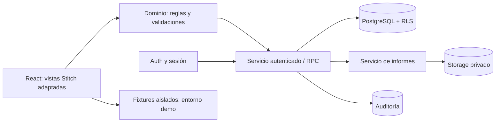
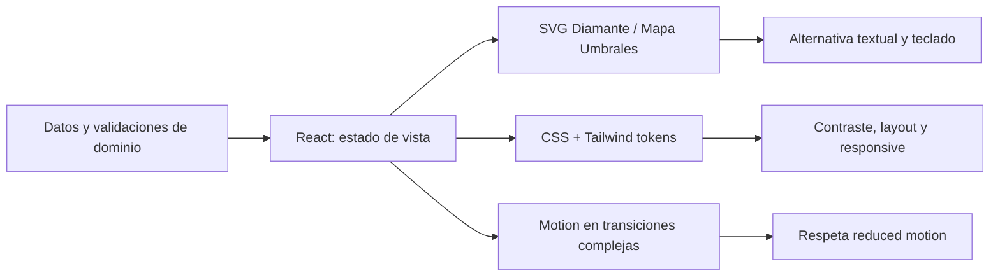

# 02 · TRD — ARQUITÉ | Arquitectura y contratos técnicos

**Versión:** 6.1 · 03/11/2026  
**Clasificación:** propuesta técnica de implementación, alineada con los requisitos [CONFIRMADO] de v5. **No implica que exista código de producción**.  
**Orden de autoridad:** 01 PRD + especificación v5 > código del demo v4 una vez inspeccionado > archivos `code.html` de Stitch (referencia de presentación).

## 1. Principios de arquitectura

1. **Una fuente de verdad:** backend autenticado para datos operativos; no guardar decisiones finales solo en navegador.
2. **Seguridad en servidor:** roles y pertenencia no dependen de `role`, `journey_id` o parámetros controlados por frontend.
3. **Separación de responsabilidades:** componentes visuales, reglas de dominio, acceso a datos, auditoría, generación documental.
4. **Progreso por módulo y por versión:** cómputo derivado de campos reales; ninguna regla de 29 global condiciona informes.
5. **Snapshots inmutables:** cierre y renovación de diamantes transaccionales; no actualizar texto de versiones cerradas.
6. **Conservación contextual:** preservar funcionalidades del demo v4 una vez comprobadas; no traducir prototipo Stitch como arquitectura de runtime.
7. **Sin sobreingeniería:** evitar microservicios, analítica de IA, scores y colas externas sin caso real.

## 2. Stack propuesto, NO atribuido como decisión aprobada

| Capa | Propuesta | Motivo / condición |
|---|---|---|
| Frontend | React 19.3 compatible + Vite 8.3.x + TypeScript tras inspección del repo + Tailwind CSS 4 + CSS moderno | Base de alto rendimiento y diseño libre; **verificar** dependencia existente antes de instalar |
| Componentes | Design system propio, SVG de 10 facetas, Radix Primitives cuando sea útil, iconos existentes | Máxima fidelidad al diseño y accesibilidad sin imponer plantillas visuales |
| Animación | CSS transitions nativas + Motion for React (selectivo), React ViewTransition donde convenga sin duplicar animaciones | Interacciones premium y estados suaves sin sacrificar rendimiento ni movimiento reducido |
| Dominio | Funciones puras + validación de esquemas | Separar cierre, progreso, comparación y estados de UI |
| Autenticación | Supabase Auth **[PROPUESTA]** | Cuentas y sesiones; administrar permisos robustos, política de recuperación |
| Persistencia | Supabase PostgreSQL **[PROPUESTA]** | Versiones, historial, auditoría y RLS; el nombre «Supabase» del antiguo doc 05 no acredita una decisión ARQUITÉ |
| Archivos | Storage privado o almacenamiento equivalente con ACL | PDFs finales, respaldos autorizados y archivos permitidos |
| PDF | Servicio/backend protegido con renderizador HTML→PDF verificable | A4, fuentes, paginación y texto íntegro; render servidor, no confiar en un botón de maqueta |
| Hosting | Frontend por definir; backend autenticado; CI/CD | Nada privado en archivos estáticos ni endpoints anónimos |
| Pruebas | Unitarias + integración DB + E2E navegador + regresión visual + a11y | Pruebas en dobles ciclos, seguridad, informes, efectos y responsive |

**Decisión de implementación:** preparar un `Repository` abstracto (`demoRepository`, `secureRepository`) e intercambiarlo al conectar backend; **no** permitir que el selector de un demo opere sobre datos reales.

## 3. Arquitectura de capas y flujo de datos



La interfaz visual no determina autorizaciones. Los formularios visuales deben escribirse con accesibilidad, estado y validación; los botones de Stitch sin conexión a datos no acreditan capacidades de API.

## 4. Organización de código sugerida; adaptar al repositorio real

```text
src/
  app/                 # rutas, layouts, sesión
  components/          # Button, Card, Badge, Dialog, Accordion, etc.
  features/
    access/            # login, registro, recuperación
    panorama/          # overview, siguiente acción, progreso
    diamond/           # SVG 10 facetas, exploraciones, decisiones, A/B
    thresholds/        # mapa 2/3/2, evidencias, timeline
    interventions/     # siete planes independientes
    letters/           # personal/profesional y editor
    reports/           # previews, exportación, estados
    administration/    # recepciones, expediente, auditoría
  domain/
    completeness.*     # 13/13, 7/7, 2/2, 7/7 y global 29
    diamond-machine.*  # S0..S7 y guardias
    comparison.*       # marcado literal de cambios
    schemas.*          # validación estructural
  data/
    repository.*        # interfaz y adaptadores
    demo-fixtures.*     # datos sintéticos explícitos
    secure-repository.*
  styles/tokens.css
  test/
supabase/migrations/ # solo si se aprueba Supabase
docs/adr/
```

**No instalar** Tailwind por CDN de Stitch para producción. Extraer su estructura visual y portar a los estilos/stack existentes. No crear scaffolds que destruyan trabajo previo.

## 5. Contratos de dominio

```ts
// Pseudotipos de referencia, no código definitivo
// Las constantes de catálogo se validan contra demo real.
type Dimension = 'personal' | 'profesional';
type ContextType = 'entorno' | 'talentos' | 'posibilidades';
type DiamondState = 'draft' | 'closed';
type Slot = 'A' | 'B';
type ModuleType = 'diamond' | 'thresholds' | 'letters';
type ThresholdState = 'sin_iniciar' | 'en_exploracion' | 'accion_experimentada' | 'cambio_documentado';
interface VersionId { id: string; journeyId: string; number: number; slot: Slot; state: DiamondState; revision: number; }
interface DiamondAnswer { versionId: string; dimension: Dimension; decisionIndex: 1|2|3|4|5; text: string; }
interface DiamondContext { versionId: string; type: ContextType; text: string; }
```

**Identificadores canónicos** para respuestas: `(version_id, dimension, decision_index)` y `(version_id, context_type)`; nunca indexar por texto visible de preguntas. La versión cerrada conserva snapshot de respuestas y contexto, fecha, autor y hash. Identificadores de umbrales `1..7` no deben cambiar de semántica sin migración aprobada.

## 6. Reglas derivadas y guardas

```text
esNarrativaValida(texto) = trim(texto).length >= MIN_CHARS (propuesta inicial 10)
completitudDiamante(v) = (exploraciones_validas + decisiones_validas) / 13
facetasIluminadas(v) = contar decisiones válidas entre 10
completitudUmbrales(j) = contar umbrales con estado seleccionado + evidencia válida / 7
completitudCartas(j) = contar cartas narrativamente válidas / 2
completitudIntervenciones(j) = contar planes válidos / 7
completitudGlobal(j) = (completas_contextos + completas_decisiones + completas_umbrales + completas_intervenciones + completas_cartas) / 29
```

Para evitar precedencia ambigua: `completitudUmbrales` cuenta **registros completos**, donde cada uno cumple las dos condiciones (estado+evidencia), no suma componentes por separado. `completitudGlobal` usa el diamante actual/elegido y no duplica A y B. Los denominadores son constantes de contrato; sus validaciones son propuestas parametrizables donde v5 las deja abiertas. Se derivan en backend para validar cierre; UI puede calcular previsualización sin autoridad para fijar estado.

## 7. Máquina del doble diamante y operaciones críticas

| Operación | Guarda | Resultado persistente |
|---|---|---|
| `saveDiamondDraft` | Propietario, versión `draft`, revisión esperada | Autosave + incrementa revisión, sin alterar otra versión |
| `closeDiamond` | Propietario, 13/13 validado en servidor, confirmación fresca | Snapshot y hash, `closed_at`, `confirmed_by`, evento, inmovilidad |
| `createSecondVersion` | Solo una versión cerrada, no existe B | B como nuevo borrador **vacío**, A lectura |
| `compareDiamond` | Versión(s) autorizada(s) | Diferencias textuales/fechas; sin score |
| `requestRenewalPreview` | Dos diamantes cerrados | IDs y fechas exactas + token de consentimiento a versiones específicas |
| `renewDiamond` | Propietario; dos cerrados; token + aceptación expresa + idempotency key | Elimina/reemplaza A según política, traslada reciente a A y crea nuevo B borrador, todo atómico |

**Atomicidad y concurrencia:** transacción de escritura con bloqueo por `journey_id` y revisión de versiones; doble petición con misma clave debe devolver el mismo resultado sin volver a eliminar otro diamante. Si falla un paso, rollback. `UNIQUE(journey_id, slot)` en slots activos, máximo 2. El backend debe rechazar cualquier intento de editar respuesta cerrada, incluso desde admin.

**Política de eliminación:** reemplazar versión antigua elimina del comparador y, **por defecto recomendado**, del contenido operativo; guardar metadatos de sustitución sin respuestas ocultas. Alinear retención de backups con aviso y política aprobados antes de producción.

## 8. Módulos independientes y ediciones

- `closeThresholds`: **[PROPUESTA]** valida siete registros, presenta revisión y fija edición documentable; las modificaciones futuras abren otra edición/historial de eventos reales, sin semántica de slots A/B.
- `closeLetters`: **[PROPUESTA]** valida dos cartas, fija snapshot de ambas; una carta individual sellada visualmente no desbloquea el PDF final si la otra sigue incompleta.
- `saveIntervention`: añade/actualiza plan con tipo, acción, evidencia; no cambia elegibilidad de `closeThresholds`.
- `module_closures`: sirve como registro de snapshot, fecha, autor y documento de cierre separado por módulo; **no** hay «cierre global» como requisito.

## 9. Diseño de rutas y operaciones de servicio (orientativo)

| Ruta / RPC conceptual | Método | Autorización | Resultado |
|---|---|---|---|
| `/auth/*` | sign-in/up/recovery | Auth | Sesión, no rol editable |
| `/me/journey` | GET | Participante propio | Resumen de módulos y versión activa |
| `/me/diamond/versions/:id` | GET / PATCH | Participante propietario; patch solo `draft` | Lectura / autosave conflict-safe |
| `/me/diamond/versions/:id/close` | POST | Propietario, 13/13 | Snapshot inmutable |
| `/me/diamond/renewal-preview` | POST | Propietario, dos cerrados | Contrato de sustitución y token |
| `/me/diamond/renew` | POST | Propietario, token+consent+idempotencia | Swap+creación atómicos |
| `/me/thresholds/:index` | PATCH | Propietario | Actualización + evento histórico |
| `/me/thresholds/close` | POST | Propietario, 7/7 | Cierre independiente |
| `/me/letters/:dimension` | PATCH | Propietario | Guardar carta/edición |
| `/me/letters/close` | POST | Propietario, 2/2 | Cierre independiente |
| `/me/reports/:module` | POST | Propietario, módulo cerrado | Job/snapshot PDF; ruta privada |
| `/admin/receipts` | GET | Administrador | Paginación y filtros de registros conservados |
| `/admin/participants/:id` | GET | Administrador | Expediente autorizado; consulta auditada |

No definir endpoints HTTP nuevos si el repositorio usa RPC directa con Supabase; la tabla expresa **contratos de servicio**, no obligación de servidor Node dedicado. Las autorizaciones deben validarse en cada llamada.

## 10. Reportes: renderizado confiable

1. Backend verifica rol, titularidad y snapshot cerrado; usa **snapshot persistido**, no el estado abierto en navegador.
2. Construye un modelo de documento del módulo y aplica plantilla editorial diferenciada (ver 04).
3. Genera HTML accesible y PDF A4 desde servicio compatible. El SVG de diamante debe ser vectorial y textos largos paginar.
4. Almacena temporal o persistentemente según retención en bucket privado; devuelve descarga autorizada de corta vida.
5. Guarda `report_exports` con versión/edición, actor, tipo, fecha, hash del contenido y resultado.
6. Prueba caracteres especiales, saltos, 10 textos de longitud alta, dos cartas largas, conexión interrumpida y acceso cruzado.

No prometer que Supabase Edge Functions por sí solas ejecutan un navegador para imprimir sin validar su entorno; seleccionar el renderizador realmente compatible durante implementación.

## 11. No funcionales y seguridad

| Área | Criterio de salida |
|---|---|
| Accesibilidad | WCAG 2.2 AA como objetivo, teclado, lector de pantalla, `prefers-reduced-motion`, estados por texto, contraste verificado |
| Responsive | Desktop 1440/1366/1024, tablet 768, móvil 390; diamante comparativo sin superposición; textos completos |
| Integridad | Ningún autosave sobrescribe snapshot ni responde éxito si falló; control de revisión optimista |
| Auditoría | Evento con actor, entidad, acción, instante, IDs, sin incluir textos completos sensibles innecesarios |
| Privacidad | Acceso aislado por usuario; PDF y cartas privados; pruebas de RLS/ACL y exportaciones |
| Disponibilidad | Estados guardando/guardado/error; reintento sin duplicación; backup y recuperación aprobados |
| Calidad | Lint, build, unitarias, integración DB, E2E, pruebas de regresión del demo antes del cambio |

## 12. Pruebas técnicas mínimas

`D01` first-run solo inicial; `D02` cierre fallido 12/13; `D03` cierre válido 13/13; `D04` intento UPDATE a versión cerrada denegado; `D05` comparación A/B de todos los 13 campos; `D06` cancelar renovación conserva dos; `D07` token de reemplazo caducado o IDs cambiados se rechaza; `D08` concurrencia y retry deja dos slots; `D09` 7/7 umbrales sin cartas permite solo su informe; `D10` cartas 2/2 sin diamante permite solo cartas; `D11` admin ve registros autorizados y auditoría; `D12` usuario no ve otro, ni por bucket; `D13` PDF fiel al snapshot; `D14` demo sin datos reales.

## 13. Referencias y restricciones de fuente

- Requisitos: `fuentes/ARQUITE_Especificacion_Funcional_y_Backlog_Actualizada_v5.md`, especialmente §§3,4,5,7,8,10.
- Visual HTML/CSS a portar, **no** backend implementado: `referencias_stitch/*/code.html`, `referencias_stitch/warm_editorial_roadmap/DESIGN.md`.
- **Pendiente de aportar o localizar en repositorio:** HTML de demo v4 original, package.json real y configuración de plataforma; el v5 **describe** el demo, pero el ZIP nuevo no lo contiene.


## 14. Revisión 2026 del stack visual: decisión razonada

**Hecho verificado en documentación oficial (03/11/2026):** React 19.3 ha estabilizado `ViewTransition`; Vite 8.3 es la rama mantenida de Vite 8; Tailwind 4 usa CSS-first `@theme`; Motion for React soporta transiciones de layout, gesto y scroll. Estas capacidades **no demuestran que estén instaladas en el repositorio de ARQUITÉ**. Verificar versiones y compatibilidad del `package-lock` antes de cualquier upgrade.

| Necesidad de ARQUITÉ | Herramienta prioritaria | Alternativa / condición | Motivo |
|---|---|---|---|
| Estética idéntica a Stitch sin apariencia genérica | CSS Grid/Flex + Tailwind 4 + custom properties + CSS Modules puntuales | Uno solo de Tailwind/CSS-in-JS como base; evitar duplicaciones | Total control sobre paper canvas, editorial grid, serif, ritmos y capas |
| Animaciones de interacción y cambio de versión | Motion for React | React `ViewTransition` para cambios de rutas simples, sin animación duplicada | Animaciones interrumpibles, layout compartido y estados fluidos |
| Aparición y hover de elementos triviales | CSS transitions/`@starting-style` | Sin JS de animación | Menor coste de ejecución y bundle |
| Diamante distintivo de diez facetas | **SVG nativo React** + CSS/Motion | `d3-shape`/`@visx` únicamente si cambia la geometría | 10 superficies discretas no justifican canvas ni WebGL |
| Mapa de 7 umbrales por 3 bandas | Grid + SVG conectores + panel accesible | `@visx` si se agregan relaciones temporales geométricamente complejas | Su significado es narrativo/categórico, no una medición científica numérica |
| Tablas de recepciones personalizables | HTML semántico; TanStack Table si requiere orden/paginación complejos | No agregar por solo 6 filas mock | Diseño admin propio con controles robustos |
| Datos entre pantallas | TanStack Query cuando haya API real | `fetch`/cliente existente para páginas simples | Evita cache obsoleta y estados de carga sin tocar contratos de DB |
| Elementos accesibles | Radix UI headless para Dialog/Tabs/Accordion | Adaptar si ya existe librería equivalente | Gestión de foco y teclado sin alterar aspecto visual |
| Estética cinematográfica 3D | **No en MVP** | R3F v9 + Three.js **solo en laboratorio optativo** | Rendimiento, lectura, accesibilidad y PDF pesan más que brillo ornamental |

**No recomendado:** reemplazar Vite por Next.js sin necesidad de SSR/SEO, añadir GSAP y Motion en los mismos componentes, usar un render 3D como única forma del diamante, introducir un sistema CSS-in-JS paralelo, o instalar librerías de componentes de estética ajena a Stitch.

### 14.1 Arquitectura de interacción visual



- La **identidad visual** reside en variables compartidas y componentes propios, no en capturas convertidas a ``.
- Los **datos** determinan estados de facetas, versiones, fechas y elegibilidad; las animaciones solo **reflejan** esos estados.
- La UI debe mantener la misma información con JS de animación desactivado y con `prefers-reduced-motion: reduce`.
- Las operaciones `close`, `renew` y `download` no dependen del fin de una animación para confirmarse.
- Si hay scroll narrativo, usar solo en secciones introductorias, nunca para ocultar botones de cierre o lectura de cartas.

### 14.2 Presupuesto de calidad medible [PROPUESTA]

| Indicador | Objetivo / comprobación |
|---|---|
| Experiencia perceptiva | Interacción de facetas y acordeones sin saltos de layout; animaciones cortas (120–300 ms salvo contenido complejo) |
| Core Web Vitals | Medir LCP, INP y CLS en staging, móvil y equipo modesto; presupuestos finales basados en resultados, no cifras inventadas |
| Paquete JS | Medir bundles por ruta; carga diferida de administrador y reportes; SVG renderizable sin motor 3D |
| Accesibilidad | WCAG 2.2 AA como objetivo; foco visible, semántica, reduced motion, contrastes, lector de pantalla |
| Fidelidad visual | Comparativa Stitch vs React en 1440, 1366, 1024, 768 y 390 px; cambios explícitos por mejora de UX |
| Resiliencia | Guardado visible, errores recuperables, confirmaciones independientes del render y reintentos idempotentes |

### 14.3 Referencias oficiales del stack

- React 19.3 y `ViewTransition`: https://react.dev/blog/2026/09/09/react-19-3
- Vite releases y Vite 8: https://vite.dev/releases
- Tailwind 4 CSS tokens: https://tailwindcss.com/docs/theme
- Motion for React: https://motion.dev/docs/react y https://motion.dev/docs/react-layout-animations
- Radix UI: https://www.radix-ui.com/primitives
- TanStack Table: https://tanstack.com/table/latest/docs/overview
- visx: https://airbnb.tech/opensource/visx/
- React Three Fiber: https://r3f.docs.pmnd.rs/
- W3C reduced motion: https://www.w3.org/WAI/WCAG22/Techniques/css/C39
