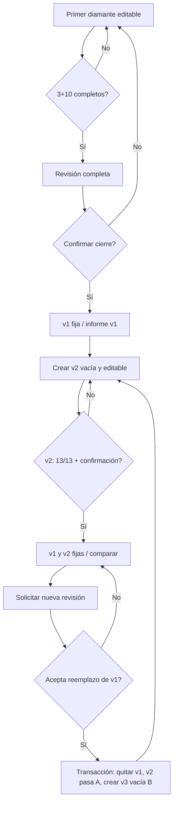
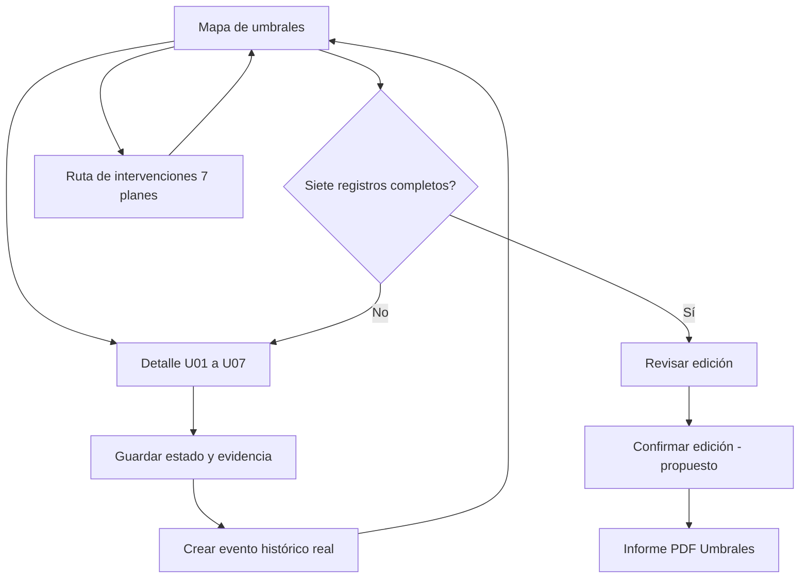

# 03 · App Flow — ARQUITÉ | Flujos UX y recorridos

**Versión:** 6.1 · 03/11/2026  
**Función de este documento:** convertir el PRD y v5 en rutas, pantallas, estados, transiciones, mensajes y pruebas de experiencia. Las pantallas del ZIP Stitch son **maquetas**, no evidencia de persistencia.  
**Prioridad:** reglas v5 > lógica reportada del demo v4 > propuesta visual Stitch.

## 1. Navegación y arquitectura de información

**Navegación autenticada del participante [PROPUESTA basada en Stitch]:** `Panorama | Mi Diamante | Siete Umbrales | Cartas al Futuro | Informes`. La Ruta de intervención y Bitácora se integran en la experiencia de Umbrales o como subrutas accesibles; no desaparecerán porque Stitch no les dedique una pantalla independiente. **Administración** solo aparece para usuarios con ese rol verificado.

**Navegación secundaria de Mi Diamante:** `Vista actual | Versión anterior | Comparar | Las tres exploraciones | Las cinco decisiones (personal/profesional) | Historial | Informe`. Cuando solo existe v1, el comparador/segunda versión debe verse bloqueado con explicación, no sugerir que es una «versión de referencia» genérica.

**Umbrales:** `Mapa 3 capas | Detalle de umbral | Historial de cambios | Ruta de intervención | Informe`. **Cartas:** `Personal | Profesional | Revisión | Informe`.

**Principio de interacción:** cada vista explica *qué está completo*, *qué falta*, *qué acción sigue* y *qué consecuencia tiene confirmar*. Los cambios destructivos nunca se disparan por tocar una tarjeta.

## 2. Inventario de pantallas y anclaje a Stitch

| ID | Vista funcional de ARQUITÉ | Archivo visual ZIP | Necesario adaptar / no asumir |
|---|---|---|---|
| P00 | Registro de participante | `registro_simple_arquit` | Formulario real, consentimiento y errores; nunca cuentas ficticias oficiales |
| P01 | Login sencillo de participante/admin | `acceso_directivo_simple_arquit` | Auth real; evitar selectores de rol como autorización |
| P01a | Acceso directivo avanzado [ALTERNATIVA] | `acceso_directivo_arquit` | Passkey/FIDO2, «custodia» y autenticación institucional no están confirmados |
| P02 | Panorama y estado por módulo | `panorama_arquit` | Datos dinámicos y reporte por módulo, no dossier obligatorio único |
| P03 | Mi Diamante y versión activa | `mi_diamante_arquit` | Dos versiones de una persona, exploraciones **por versión**, 10 facetas y 13 requisitos |
| P03a | Desplegables y edición de contenidos | `gu_a_de_desplegables_mi_diamante_siete_umbrales` | Guía de patrón interactivo; no demuestra persistencia ni valida contenidos |
| P04 | Comparador A/B, cierre y renovación | No hay vista final equivalente en ZIP | **Diseñar nueva** siguiendo estilo de P03; estados, revisión y consentimiento esenciales |
| P05 | Siete Umbrales | `siete_umbrales_arquit` | 3 capas 2/3/2; resolver diferencias nominales contra v5/demo antes de fijar catálogo |
| P06 | Ruta de intervención y bitácora | No hay pantalla autónoma en ZIP | **Diseñar** usando tarjetas y desplegables de P03a/P05; 7 planes independientes |
| P07 | Cartas personal/profesional | `cartas_al_futuro_arquit` | Editor, borradores, texto íntegro y **cierre del módulo 2/2** |
| P08 | Informes de cada módulo | `informe_dossier_arquit` | Estética editorial **reutilizada tres veces**, no descargar un dossier global en lugar de cada PDF |
| P09 | Panel administrador / recepciones | `panel_administrador_arquit` | Búsqueda, paginación, expedientes autorizados, respuestas, auditoría, cifras reales |
| P10 | Expediente administrativo detallado | Modal de P09 como referencia | Debe incluir 3 exploraciones/10 respuestas por versión, 7 umbrales, 7 planes, 2 cartas y cierres |

Rutas de URL orientativas [PROPUESTA]: `/registro`, `/acceso`, `/panorama`, `/diamante`, `/diamante/comparar`, `/umbrales`, `/intervenciones`, `/cartas`, `/informes/:module`, `/admin`, `/admin/participantes/:id`. Rutas reales deben respetar router existente y un guard de autorización en servidor; no basta ocultar menú.

## 3. Recorrido de primer acceso y primer diamante (S0–S3)

1. **Llegada:** usuario abre P00 o P01, inicia sesión, ve finalidad del tratamiento y acceso de administrador a sus respuestas antes de comenzar.
2. **Primera sesión:** P02 presenta los tres módulos y su estado. P03 muestra `Versión inicial (v1)` editable; el espacio de actualización figura bloqueado con el mensaje «Podrás crear otra versión después de confirmar la primera».
3. **Captura:** tres exploraciones (Entorno, Talentos, Posibilidades) y diez decisiones (5 personales y 5 profesionales). P03a permite abrir desplegables, editar y guardar.
4. **Retroalimentación:** contador estructural `x/13`; a la par, SVG con `x/10` facetas coloreadas. Mostrar siempre ambos conceptos; no afirmar calidad o puntuación.
5. **Guardado:** autosave con `Guardando...` / `Guardado` / `No se guardó: reintentar`; datos nunca se confirman como guardados antes de respuesta del backend.
6. **Revisión:** al llegar a 13/13 aparece `Revisar y confirmar diamante`, que abre página/modal de lectura completa con las 3+10 respuestas, metadatos, efecto de cierre y dos acciones: `Volver a revisar` y `Confirmar y fijar diamante`.
7. **Cierre:** tras confirmación explícita, backend sella v1; P03 cambia a solo lectura, fecha y nº de versión; ofrece `Descargar informe v1` y `Crear mi actualización`.

**Errores deliberados que se deben probar:** cerrar con 12/13; texto con solo espacios; vencimiento de sesión; fallo de red tras presionar confirmar; cambio de contenido en otra pestaña mientras se revisa. Los errores no deben dejar una versión mitad cerrada.

## 4. Segundo diamante, comparación y renovación (S4–S7)

**Creación de B:** después del primer cierre, `Crear mi actualización` crea B vacía y editable (no clona respuestas). P03 dispone una lectura de A y edición de B; `Copiar de versión anterior` es **[PROPUESTA]** botón explícito por campo, nunca prellenado automático.

**Comparación de lectura:** P04 muestra dos paneles con fechas/versiones claramente visibles, pestañas para 3 exploraciones y 10 decisiones, marcas **modificado / sin cambios / agregado**, respuestas completas y alternativas de navegación accesibles. Evitar puntuación, radar o porcentaje de «mejora». Si B sigue en borrador se rotula «Comparación con borrador», no con nueva versión confirmada.

**Cierre de B:** con 13/13 + confirmación, A y B quedan fijas; P04 permite PDFs individuales y comparativo. `Iniciar nueva revisión` abre aviso de sustitución, **no** crea v3 inmediatamente.

**Consentimiento:** P04 debe mostrar nombre/nº/fecha de versión antigua y reciente, resultado explícito («v2 se conservará como referencia; v1 dejará de estar disponible; v3 comenzará vacía»), recomendación de descarga, checkbox no premarcado y `Cancelar` / `Acepto sustituir ...`. Confirmación ejecuta una sola operación segura. Cancelar mantiene ambos.

### 4.1 Microcopy crítico de renovación

**Título:** «Revisar reemplazo de la versión anterior». **Detalle:** «Tienes dos versiones confirmadas: [nº y fecha antigua] y [nº y fecha reciente]. Para comenzar otra revisión, la versión más antigua dejará de estar disponible en el comparador. La más reciente se conservará como referencia. Descarga la antigua si deseas conservar una copia». **Aceptación:** «Comprendo qué versión se sustituirá y autorizo esta operación». **Botón:** «Sustituir versión antigua y crear nueva revisión». **Cancelación:** «Conservar mis dos versiones».

No usar la etiqueta «Eliminar todo» ni acción irreversible sin detalle. Incluir accesibilidad del diálogo: `aria-labelledby`, foco inicial informativo, foco de retorno y estado de procesamiento; botón deshabilitado mientras operación en curso.

## 5. Recorrido de Siete Umbrales

1. Desde P02 entra a P05. Ve 3 agrupaciones de 2/3/2 tarjetas; estado textual y progreso `x/7`. El mapa no presenta ranking personal.
2. Abre estación en desplegable o panel lateral. Lee definición y pregunta del catálogo **aprobado**, selecciona estado permitido y escribe reflexión/evidencia.
3. Guarda; se crea entrada de evento **solo si hubo modificación real**, con actor y fecha. `Actualizado` refleja evento, no madurez.
4. Reabre meses después, observa «Versión anterior de esta reflexión» únicamente si hay historial real, con la fecha correspondiente.
5. Al completar 7/7 se habilita informe de umbrales; **[PROPUESTA]** primero revisión y confirmación editorial de una edición cerrada.
6. Enlace a P06: registra los siete planes de intervención y su evolución, **independientes** del 7/7 de los umbrales.

**Diferencia de nomenclatura no resuelta:** la maqueta P05 utiliza títulos distintos de los 7 propuestos por v5. Hasta validar catálogo real, emplear IDs U01–U07 para persistencia y texto configurado por catálogo versionado; no migrar por coincidencia parcial de nombres.

## 6. Recorrido de Cartas al futuro

1. En P07 aparecen pestañas `Carta personal` y `Carta profesional`, separando borradores y fechas.
2. Escribe texto sin límite de pantalla; se conserva estructura de párrafos; mostrar estado persistente de guardado.
3. «Sellar carta» en Stitch es una **metáfora visual**: no se debe confundir con cierre definitivo del **módulo** de cartas. Reglas de sellado individual son **[PENDIENTE]**.
4. Con las dos cartas válidas (`2/2`) se habilita `Revisar y confirmar cartas` **[PROPUESTA]** y PDF final independiente; con `1/2`, descarga individual solo si se rotula `Borrador`, salvo aprobación diferente.
5. Si se permite nueva edición futura, se crea edición nueva sin editar retrospectivamente el PDF final ya emitido **[PROPUESTA]**.

## 7. Recorrido del administrador

1. Usuario con rol admin real accede P01 y se dirige a P09 (nunca por selector de rol del navegador).
2. P09 presenta KPIs de participantes, módulos cerrados, procesos activos y última actividad, calculados de base; cifras de Stitch son ficticias.
3. Usa búsqueda y filtros por nombre/alias, módulo, estado, fechas y versión; la consulta es paginada.
4. Abre `Ver expediente` P10. Se visualizan versiones cerradas **retenidas**, respuestas completas, estados, hitos, umbrales, intervenciones, cartas y entregables autorizados.
5. Descarga por módulo (Diamante, Umbrales o Cartas) y consulta auditoría; cada consulta sensible registra actor, expediente y fecha sin replicar el texto privado en logs.
6. No puede reabrir un diamante confirmado ni recuperar texto de una versión sustituida si fue eliminado conforme a política.

## 8. Estados vacíos, conflictos, mensajes de error

| Caso | Mensaje o comportamiento esperado |
|---|---|
| No existe B | «Completa y confirma tu versión inicial para crear una actualización» |
| Diamante 10/10 facetas, 2/3 exploraciones | «Tus decisiones están completas, pero falta una exploración para confirmar (12/13)» |
| Guardado pendiente | Indicador `Guardando...`; la navegación previene pérdida sin alarmismo |
| Red caída | «No pudimos guardar los cambios. Conservamos tu texto en esta sesión. Reintentar»; no prometer persistencia |
| Conflicto de revisión | «Hay una versión más reciente. Revisa los cambios antes de volver a guardar» |
| Usuario intenta cerrar documento 6/7 | Mostrar estación faltante y enlace, no PDF final |
| Renovación sin checkbox | Bloqueo de botón y explicación de consentimiento |
| Sesión caducada | Reautenticación, sin filtrar datos en URL, cache o pantalla pública |
| Admin sin derecho a expediente | Denegación sin revelar respuestas o metadatos innecesarios |
| PDF falla | Reintento controlado; mantener estado confirmado intacto |
| Histórico de umbral sin cambios previos | No inventar comparación; «Esta es la primera reflexión registrada» |
| Maqueta contiene «Dossier completo» | Sustituir por selector de tres informes independientes; un compilado sería extra opcional |

## 9. Accesibilidad y responsive

P02/P03/P05 deben tener estructura `h1/h2/h3`; los desplegables se abren por teclado, exponen `aria-expanded` y no esconden el estado de campos pendientes. El diamante SVG necesita leyenda textual/listado de 10 facetas con estado; los mapas 2/3/2 tienen alternativa de lista. A/B en escritorio 2 columnas, en móvil paneles apilados con selector y fechas siempre visibles. Diálogos de confirmación con foco y ESC solo donde no dispare pérdida. Probar 1440, 1366, 1024, 768 y 390 px, teclado, zoom 200% y lectura de párrafos extensos.

## 10. Pruebas de recorrido E2E

`UX-01` primer acceso; `UX-02` 12/13; `UX-03` cierre 13/13; `UX-04` creación B vacía; `UX-05` comparación 13 campos; `UX-06` aviso reemplazo con IDs y fechas correctas; `UX-07` cancelar; `UX-08` aceptar y reintentar; `UX-09` umbral sin historial; `UX-10` siete completos solo habilitan PDF umbrales; `UX-11` una carta incompleta impide PDF final de cartas; `UX-12` admin revisa expediente y exporta autorizado; `UX-13` participante no ve datos de otro; `UX-14` accesibilidad y vista móvil; `UX-15` el valor ficticio de Stitch jamás figura como registro real sin seed explícito.

## 11. Trazabilidad

- V5 §§3–7, 10 y casos T01–T19.
- Maquetas: `referencias_stitch/*/screen.png` y sus `code.html`; guía de desplegables especialmente P03a.
- **Faltantes que no deben inventarse:** el catálogo definitivo de títulos de umbrales, flujo exacto de recuperación de cuentas, política de sellado de cartas y diseños nuevos de comparación A/B y Ruta de intervención.

## 12. Microinteracciones por recorrido y límites de animación

| Recorrido | Transición sugerida | Salvaguarda UX |
|---|---|---|
| Panorama → Mi Diamante | Resalte compartido de tarjeta/título, aparición serena del SVG | No bloquear la navegación mientras anima |
| Explorar una faceta | Faceta cobra color si su decisión es válida; revela detalle textual | Etiqueta y `aria-label` redundan el estado, no solo color |
| Guardar una respuesta | Indicador in situ `Guardando`→`Guardado` o `No guardado` | Jamás anunciar éxito antes del backend |
| Seleccionar A o B | Panel de diamante se desliza mínimamente, muestra fecha y etiqueta editable | A nunca recibe cursor o CTA de edición |
| Comparación A/B | Apertura coordinada de columnas con marcas de diferencia | Lectura en orden secuencial en móvil/lector de pantalla |
| Confirmar cierre | Diálogo con resumen de requisitos y botón explícito | Sin efecto visual irrevocable hasta respuesta exitosa |
| Reemplazo v1→v2/v3 | Vista previa y casilla; tras commit animar el traspaso v2 a A | Cancelación y fallo mantienen estado previo sin animar desaparición |
| Umbrales | Tarjeta se expande y nodo se destaca con su estado textual | No presentar secuencia como ascenso lineal obligatorio |
| Cartas | Editor cambia a previsualización editorial del snapshot | No marcar «final» si falta segunda carta o confirmación propuesta |
| Informe PDF | Skeleton de generación y estado `Disponible` desde servidor | Error recuperable; datos completos en PDF aunque tarjeta trunque preview |

**Reglas generales:** CSS primero para `hover/focus`; Motion solo donde comunique cambio de estado o de disposición; `prefers-reduced-motion` respetado. No ejecutar lógica de cierre/renovación en `onAnimationComplete`. En fase de UI, probar funciones y transiciones desactivadas con Playwright y teclado.
