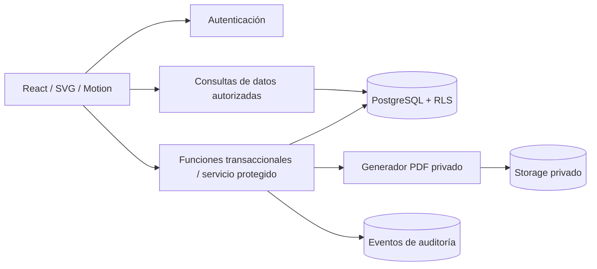
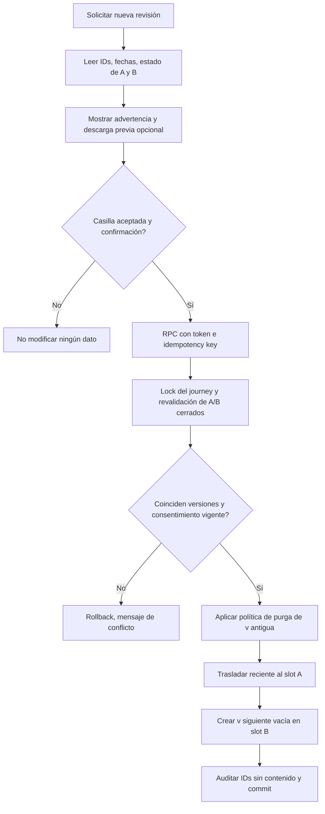

# 05 · Backend & Data Schema — ARQUITÉ | Supabase, seguridad y versionado

**Versión:** 6.1 · 03/11/2026  
**Estado:** diseño técnico objetivo para implementación, no migración desplegada.  
**Autoridad funcional:** `fuentes/ARQUITE_Especificacion_Funcional_y_Backlog_Actualizada_v5.md`.  
**Convenciones:** **[CONFIRMADO]** regla de v5; **[PROPUESTA]** diseño recomendado; **[PENDIENTE]** decisión de gobierno. Los seis DOCX originales tratan de seguimiento académico y **no** son fuente de entidades para ARQUITÉ.

## 1. Decisión arquitectónica

**[PROPUESTA]** PostgreSQL administrado en Supabase + Supabase Auth + RLS + Storage privado es apropiado para ARQUITÉ: datos relacionales, documentos personales, versionado, roles y cierres transaccionales. Reutilizar una instalación existente tras inspeccionarla; no dar por creado proyecto ni secret. React/Vite/Tailwind y los widgets SVG se consumen desde el frontend, pero ninguna validación final depende de éste.



**Fronteras:** cliente público solo con clave publicable y sesión. Nunca `service_role` en Vite, HTML del ZIP, GitHub, storage del navegador o variable pública. Funciones que eludan RLS requieren comprobación explícita de identidad, propiedad y rol, y revisión de permisos `EXECUTE`. Un selector gráfico de rol nunca otorga acceso.

## 2. Definiciones que gobiernan el esquema

- El recorrido es **de una persona** y puede tener **máximo dos versiones activas/visibles** del diamante (espacios A/B). El primer diamante es editable hasta alcanzar 13/13 y recibir confirmación; después queda inmutable.
- La segunda versión es **un nuevo corte temporal**, con **3 exploraciones + 10 respuestas propias**; nunca es «la mitad profesional» del diamante ni una plantilla estática.
- Cuando dos versiones están cerradas, un tercer ciclo solo puede crearse con consentimiento nuevo, específico a las dos versiones actuales; reemplazo y creación se ejecutan de manera **atómica e idempotente**.
- Tres entregables autónomos: **Diamante 13/13 + confirmación; Umbrales 7/7; Cartas 2/2**. La confirmación de cierres de Umbrales y Cartas es **[PROPUESTA]**. Los 7 planes de intervención son **independientes**, no bloquean los 7 umbrales.
- `29` = 3 exploraciones + 10 respuestas + 7 umbrales + 7 intervenciones + 2 cartas; es métrica de **completitud estructural**, nunca de calidad humana.
- Al reemplazar una versión, no conservar clandestinamente texto antiguo en auditoría, reportes, documentos o versiones históricas. **[PENDIENTE]** política de conservación legal, backups y exportaciones previas del usuario.

## 3. Entidades y relaciones propuestas

| Entidad | Claves / campos esenciales | Integridad / finalidad |
|---|---|---|
| `profiles` | `id uuid PK` = `auth.users.id`; `display_name`, `email_display`, `role`, `active`, `created_at`, `updated_at` | Rol `participant`/`admin` gestionado por servidor, no autoeditable |
| `consent_records` | `id`, `user_id`, `purpose`, `policy_version`, `accepted_at`, `ip_hash?` | Consentimiento para tratamiento de respuestas y acceso administrativo; no reutilizar consentimiento de privacidad como permiso de reemplazo |
| `journeys` | `id`, `owner_id`, `created_at`, `updated_at`, `revision` | Recorrido propietario; `owner_id` FK perfil |
| `diamond_versions` | `id`, `journey_id`, `version_number`, `slot A/B`, `status draft/closed`, `started_at`, `closed_at`, `confirmed_by`, `revision` | Índice único `(journey_id, slot)` para versiones **activas**; `version_number` irrepetible por recorrido |
| `diamond_contexts` | `version_id`, `context_key`, `body`, `updated_at` | 3 exploraciones aisladas por versión. PK `(version_id, context_key)` |
| `diamond_answers` | `version_id`, `dimension`, `decision_index`, `body`, `updated_at` | 5 por dimensión; PK `(version_id, dimension, decision_index)` |
| `threshold_catalog` | `catalog_version`, `threshold_key U01..U07`, `band`, `title`, `help_text`, `active` | Catálogo versionado; **conflicto de nombres** entre v5 y Stitch pendiente de validación |
| `threshold_records` | `journey_id`, `threshold_key`, `catalog_version`, `status`, `reflection`, `evidence`, `updated_at`, `revision` | 7 registros vigentes por recorrido; estado+evidencia/reflexión para completo |
| `threshold_events` | `id`, `journey_id`, `threshold_key`, `previous_value`, `new_value`, `actor_id`, `occurred_at`, `revision` | Historia real de cada umbral; acceso restringido; contenido anterior explícitamente tratado como dato personal |
| `interventions` | `journey_id`, `threshold_key`, `kind`, `action_text`, `evidence_text`, `updated_at` | 7 planes con tipos cognitivo/emocional/simbólico/estratégico según catálogo v4 confirmado en preflight |
| `letters` | `journey_id`, `dimension personal/professional`, `body`, `updated_at`, `revision` | Dos cartas editables; no identificarlas por encabezado visible |
| `module_closures` | `id`, `journey_id`, `module`, `edition_no`, `diamond_version_id?`, `snapshot_json`, `snapshot_hash`, `closed_at`, `confirmed_by` | Snapshots **inmutables** que alimentan PDF; tres módulos independientes |
| `replacement_consents` | `id`, `journey_id`, `old_version_id`, `recent_version_id`, `actor_id`, `consented_at`, `policy_version`, `request_id`, `result` | Registro de aceptación **sin texto completo** de versiones eliminadas |
| `report_exports` | `id`, `closure_id`, `requested_by`, `format`, `private_storage_key?`, `generated_at`, `deleted_at`, `status` | Trazabilidad de informes finales y purga de versiones antiguas |
| `audit_events` | `id`, `journey_id?`, `actor_id`, `event_type`, `target_kind`, `target_id`, `created_at`, `request_id`, `safe_metadata` | Operaciones críticas, lecturas admin, exportaciones; evitar respuestas completas |

**Cardinalidades:** `profiles 1:N journeys`; `journeys 1:N diamond_versions` a lo largo del ciclo *solo si hay política de archivo*, pero **1:2 máximo activas**; `diamond_versions 1:3 diamond_contexts`, `1:10 diamond_answers`; `journeys 1:7 threshold_records`, `1:7 interventions`, `1:2 letters`; cada módulo admite varias `module_closures` en el tiempo cuando se permite **[PROPUESTA]** abrir nueva edición.

**Aclaración histórica crítica:** Si se adopta eliminación de versiones antiguas, no será posible afirmar que la base conserva «todas las recepciones históricas». El administrador ve **todos los registros conservados**; eventos de reemplazo pueden evidenciar que ocurrió un cambio, sin reconstruir texto suprimido.

## 4. Enumeraciones, límites y constraints

```text
role: participant | admin             # facilitator solo si aprobado
slot: A | B
diamond_status: draft | closed
dimension: personal | professional
context_key: entorno | talentos | posibilidades
module: diamond | thresholds | letters
threshold_status [PROPUESTA v5]: sin_iniciar | en_exploracion | accion_experimentada | cambio_documentado
```

- `decision_index BETWEEN 1 AND 5` y `UNIQUE(version_id, dimension, decision_index)`.
- `UNIQUE(version_id, context_key)`; `UNIQUE(journey_id, threshold_key)`; `UNIQUE(journey_id, dimension)` para cartas.
- `UNIQUE(journey_id, version_number)` y `UNIQUE(journey_id, slot)` de versiones activas. Evitar crear v3 como tercera versión visible antes de liberar el slot; hacerlo dentro de la misma transacción.
- `closed_at` y `confirmed_by` obligatorios cuando `status=closed`; `draft` no puede llevar cierre.
- Respuestas de versión cerrada y `module_closures` inmutables con validación en BD/función; no bastan controles React.
- Fecha oficial de operaciones: `timestamptz` del servidor UTC. Convertir a zona horaria del usuario únicamente al presentar.
- `updated_at` del servidor y columna `revision` para optimistic concurrency. Rechazar actualización obsoleta con error explícito, nunca pérdida silenciosa.
- **[PROPUESTA]** mínimo `trim(text).length >= 10` en narrativa para contadores de completitud; no impone evaluación semántica. Parametrizar y validar antes de lanzamiento.

## 5. DDL orientativo de una parte del esquema

**No ejecutar directamente en producción:** fragmento didáctico, sin todas las funciones, grants, triggers y RLS. La migración completa se desarrollará, probará y revisará por seguridad.

```sql
create extension if not exists pgcrypto;

create type public.arq_diamond_state as enum ('draft','closed');
create type public.arq_slot as enum ('A','B');

create table public.arq_journeys (
  id uuid primary key default gen_random_uuid(),
  owner_id uuid not null references auth.users(id),
  created_at timestamptz not null default now(),
  updated_at timestamptz not null default now(),
  revision bigint not null default 0
);

create table public.arq_diamond_versions (
  id uuid primary key default gen_random_uuid(),
  journey_id uuid not null references public.arq_journeys(id),
  version_number integer not null check (version_number >= 1),
  slot public.arq_slot not null,
  status public.arq_diamond_state not null default 'draft',
  started_at timestamptz not null default now(),
  closed_at timestamptz,
  confirmed_by uuid references auth.users(id),
  revision bigint not null default 0,
  unique(journey_id, version_number),
  unique(journey_id, slot),
  check ((status='draft' and closed_at is null and confirmed_by is null)
      or (status='closed' and closed_at is not null and confirmed_by is not null))
);

create table public.arq_diamond_answers (
  version_id uuid not null references public.arq_diamond_versions(id) on delete cascade,
  dimension text not null check (dimension in ('personal','professional')),
  decision_index smallint not null check (decision_index between 1 and 5),
  body text not null default '',
  updated_at timestamptz not null default now(),
  primary key (version_id, dimension, decision_index)
);

create table public.arq_diamond_contexts (
  version_id uuid not null references public.arq_diamond_versions(id) on delete cascade,
  context_key text not null check (context_key in ('entorno','talentos','posibilidades')),
  body text not null default '',
  updated_at timestamptz not null default now(),
  primary key (version_id, context_key)
);

alter table public.arq_journeys enable row level security;
alter table public.arq_diamond_versions enable row level security;
alter table public.arq_diamond_answers enable row level security;
alter table public.arq_diamond_contexts enable row level security;

-- Sin grants ni policies aquí: mantener inaccesible hasta definir pruebas Auth/RLS.
-- Añadir políticas SOLO después de verificar funciones de propietario/admin,
-- permisos EXECUTE, grants y triggers de inmutabilidad.
```

**Atención:** el DDL muestra `on delete cascade` para eliminación del texto de versiones sustituidas; la implementación final debe purgar también cierres PDF/referencias asociadas según política, y debe evitar borrados accidentales de la versión reciente.

## 6. Políticas de autorización RLS — matriz operacional

| Operación | Participante | Administrador | Público `anon` |
|---|---|---|---|
| Ver su `journey`, versiones y respuestas | Solo su propio recorrido | Todos los conservados **si finalidad autorizada** | NO |
| Escribir exploraciones/decisiones | Solo borrador propio mediante servicio autorizado | NO para cerrados; rectificaciones con procedimiento auditado | NO |
| Confirmar versión | Solo titular con 13/13 y consentimiento fresco | NO suplantar confirmación | NO |
| Renovar A/B | Solo titular, previa aceptación específica | NO de manera silenciosa | NO |
| Editar umbrales / cartas / intervenciones | Solo propietario | Acceso operativo solo si formalmente habilitado | NO |
| Ver informes / exportar | Titular o admin con permiso | Según alcance y registro de consulta | NO |
| Consultar tabla admin y eventos | NO | Sí, con auditoría y finalidad | NO |

**Implementación [PROPUESTA]:** políticas `SELECT` con `owner_id = (select auth.uid())` o función de visibilidad segura; operaciones de negocio críticas mediante RPC transaccionales (`SECURITY DEFINER` solo cuando sea imprescindible, con `search_path` controlado, identidad validada dentro de la función, `REVOKE EXECUTE FROM PUBLIC`, grants explícitos y pruebas negativas). No confiar en «role = admin» enviado por el navegador: perfil y rol se consultan en DB desde sesión autenticada.

Para ver archivos/informes, imponer controles equivalentes en `storage.objects`; no basta con RLS de tablas. Ningún bucket con respuestas, cartas o PDF puede ser público. URLs firmadas de corta duración con autorización previa y registro de descarga.

## 7. Renovación A/B: algoritmo de transacción obligatoria



**Concurrencia:** bloquear el recorrido (`SELECT ... FOR UPDATE`) y volver a leer A/B dentro de la transacción. Tratar el mensaje del diálogo como contrato: `old_version_id`, `recent_version_id`, `revision`, `policy_version`, expiración y clave única de petición. Si el cliente repite la **misma** petición devolver su resultado previo; si cambió A/B, invalidar consentimiento.

**Restricción SQL importante:** con `UNIQUE(journey_id, slot)`, la renovación requiere liberar A (borrarlo o retirarlo de tabla activa) *antes* de mover B→A, todo en transacción; si falla la creación de B nuevo, rollback debe recuperar A viejo y B previo. No crear tercero visible intermedio.

**Purgado de contenidos:** una transacción SQL puede borrar filas y metadatos, pero borrar objetos en Storage puede requerir un proceso posterior. No prometer «eliminación atómica física» de SQL+Storage: registrar `purge_pending`, bloquear acceso de inmediato y ejecutar purga segura e idempotente con reintento/alerta, respetando SLA de eliminación comunicado. La aplicación no podrá conservar PDF/reportes antiguos accesibles sin avisar.

## 8. Cierre de módulo y política de edición

| Módulo | Precondición técnica | Cierre persistente | Qué ocurre después |
|---|---|---|---|
| Diamante | 13 registros válidos + confirmación | `diamond_versions.closed` + `module_closures` de esa versión | Inmutable; PDF individual. Comparativo si 2 versiones cerradas |
| Umbrales | 7 registros completos con estado+texto | **[PROPUESTA]** snapshot `module_closures` + cierre de edición | Historial de actualizaciones, posible nueva edición sin alterar snapshot previo |
| Cartas | 2 textos válidos | **[PROPUESTA]** snapshot `module_closures` + cierre de edición | Descarga final de ambas, individual opcional; nueva edición explícita si se habilita |
| Intervenciones | 7 planes documentados | No obliga a cerrar otros módulos | Progreso autónomo; anexo opcional cuando corresponde |

El backend **recalcula** la elegibilidad antes de cerrar y **firma** el snapshot, no acepta un porcentaje declarado desde React. `snapshot_hash` es huella de integridad, no certificación científica. Los campos narrativos originales deben preservarse *íntegros* para PDF, incluidos saltos de párrafo.

## 9. Informes: almacenamiento, privacidad y consistencia

- Un servicio privado toma `module_closures.snapshot_json` por `closure_id`, verifica titularidad/rol y produce PDF/HTML imprimible del **módulo específico**.
- **Diamante:** 10 facetas SVG, 3 exploraciones, 10 respuestas, fecha, versión; comparativo A/B solo cuando aplica.
- **Umbrales:** mapa 3 bandas / 7 estaciones y contenido completo de cada estado/reflexión; historia *real* si existe.
- **Cartas:** documento editorial con dos cartas completas, fechas y cortes de página cuidados.
- Guardar objetos bajo rutas opacas, por ejemplo `reports/{owner_uuid}/{closure_uuid}/{export_uuid}.pdf` dentro de bucket **privado**; nunca usar nombre libre o correo en la ruta.
- `report_exports` registra acto de exportar y su resultado sin contenido sensible; rutas y tiempos de validez controlados.
- **PDF se genera desde snapshot cerrado**, no desde `window.print()` de un formulario abierto con contenido cambiante. Probar Unicode, textos muy largos, reflow y truncamiento.
- Si usuario reemplaza v1 y política declara destrucción, bloquear informes de v1 y purgar documentos servidos; copias anteriormente descargadas fuera del sistema ya no son revocables.

## 10. Índices, rendimiento y escalamiento

Índices propuestos: `journeys(owner_id)`, `diamond_versions(journey_id, version_number desc)`, `threshold_events(journey_id, threshold_key, occurred_at desc)`, `module_closures(journey_id, module, closed_at desc)`, `audit_events(created_at desc, event_type)`, `report_exports(closure_id, generated_at desc)`. Consultas administrativas paginadas; filtros por módulo/estado/fecha en el servidor, no descarga de todas las cartas al navegador.

Carga esperable: la v5 no fija volumen real. **No inventar límites ni promesas de latencia**. Usar primero índices, pruebas de carga y paginación; no introducir Redis, vector DB, microservicios, Kafka ni IA para un sistema cuya complejidad mayor es integridad de versiones y buena UX.

## 11. Gobierno de datos y retención — decisiones pendientes

1. Identidad y aviso de privacidad de la plataforma; base jurídica, responsabilidades del administrador y propósito autorizado.
2. Plazo de conservación por tipo: borradores, versiones cerradas, historiales de umbral, cartas, informes, eventos y backups.
3. Significado exacto de «reemplazar» versión vieja: **recomendación v5**: eliminar contenido operativo; metadatos mínimos de acto consentido. No etiquetar como «borrado total inmediato» si backups siguen reteniéndolo.
4. Tipo de exportación administrativa, si existe: por defecto **sin incluir respuestas de cartas en CSV** y siempre auditar consultas masivas.
5. Alcance de rectificaciones, acceso de facilitadores y datos identificatorios mínimos.
6. Continuidad operativa: backups, recuperación, RPO/RTO, revocación, incidentes y responsables.

## 12. Contratos de pruebas y liberación

| ID | Prueba | Condición para pasar |
|---|---|---|
| DB-01 | Primer recorrido | v1 editable, ningún v2 previo, 0 terceros visibles |
| DB-02 | Faltan exploraciones o respuesta | Rechaza cierre aunque 10 facetas estén coloreadas |
| DB-03 | 13/13 + confirmación | Cierre, snapshot, actor/fecha y auditoría consistentes |
| DB-04 | UPDATE sobre versión cerrada (cliente/admin) | Rechazo persistente desde base/función |
| DB-05 | Dos versiones | v1 y v2 conservan sus 3+10 propios, comparador real |
| DB-06 | Cancelación renovación | Cero cambios, cero pérdida de datos |
| DB-07 | Renovación válida | v2→A, v3→B vacío, sin v1 operativa, auditoría |
| DB-08 | Doble clic / 2 sesiones | Solo una renovación, sin v4 accidental |
| DB-09 | Token caducado o versiones cambiadas | Rechazo sin pérdida |
| DB-10 | Umbrales 7/7; cartas incompletas | Solo informe umbrales habilitado |
| DB-11 | Cartas 2/2; diamante incompleto | Solo informe cartas habilitado |
| DB-12 | Participante intenta leer a otro | SELECT, RPC y Storage rechazados |
| DB-13 | Admin consulta expedientes | Ve únicamente datos conservados autorizados; evento de acceso |
| DB-14 | Reemplazo + informes de v1 | Se bloquean y purgan según política, no acceso residual |
| DB-15 | PDF texto largo / HTML malicioso | Contenido completo, escapado y renderizado sin script |
| DB-16 | Falla en generación/PDF/Storage | Error visible, reintento idempotente, sin informe incompleto anunciado como listo |

**Gate de producción:** migraciones y pruebas en staging; Auth y RLS verificadas para todas las rutas, Storage privado, análisis de permisos SQL/EXECUTE, recuperación de backup, pruebas de sustitución y políticas de retención aceptadas. Ningún usuario real hasta pasar este gate.

## 13. Referencias

- Fuente funcional: `fuentes/ARQUITE_Especificacion_Funcional_y_Backlog_Actualizada_v5.md`, apartados 3–10.
- Supabase RLS: https://supabase.com/docs/guides/database/postgres/row-level-security
- Supabase Auth React: https://supabase.com/docs/guides/auth/quickstarts/react
- Storage Access Control: https://supabase.com/docs/guides/storage/security/access-control
- OWASP ASVS: https://owasp.org/www-project-application-security-verification-standard/

**No reinterpretar los siete umbrales por títulos de Stitch sin validar la taxonomía canónica del demo real.**
