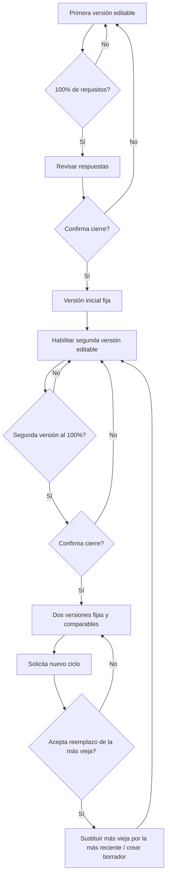

# ARQUITÉ — Especificación funcional actualizada, decisiones de producto y backlog

**Versión documental:** 5.0 · **Fecha:** 2 de noviembre de 2026  
**Estado:** especificación funcional para refinamiento / no implica que estas funcionalidades estén ya programadas.  
**Material base:** reunión del 30/10/2026 (transcripción `.vtt`), informe anterior `ARQUITE_Analisis_Reunion_2026-10-30_y_Backlog.md`, demo `ARQUITE_Demo_v4_Playing_to_Win.html` y precisiones posteriores del solicitante del 02/11/2026.  
**Fundamento estratégico:** *Playing to Win: How Strategy Really Works* (A. G. Lafley y Roger L. Martin, 2013). Se aplica como **adaptación personal/profesional**. Las tres exploraciones, los siete umbrales, las intervenciones, las cartas y la forma del diamante son componentes del artefacto ARQUITÉ: **no** son componentes oficiales del modelo de Lafley y Martin.

> **Convención de trazabilidad.** **[CONFIRMADO]** = indicación explícita del solicitante; **[DEMO]** = código existente y comprobable; **[PROPUESTA]** = solución de implementación recomendada que debe acordarse en refinamiento; **[PENDIENTE]** = decisión residual que el requerimiento no define. No confundir especificaciones con funciones ya desplegadas.

---

## 1. Resumen ejecutivo y qué cambia frente al documento anterior

El cambio central es que **«dos diamantes» ya no es una referencia estática frente a un diamante dinámico**. Son **dos versiones temporales del diamante de la misma persona**: una versión anterior **confirmada, cerrada e inmutable** y una versión posterior en la que el participante captura su actualización. Cuando ambas estén completadas y confirmadas, un nuevo ciclo solo puede comenzar tras autorizar la **sustitución del diamante más antiguo**. Nunca deben existir tres diamantes visibles simultáneamente.

Además, se confirman los cierres **independientes** de tres entregables: **informe de diamante**, **informe de siete umbrales** y **cartas al futuro**. Cada uno se habilita al alcanzar el **100% de sus propios requisitos**, no cuando el usuario termina toda la plataforma. Se requiere una **vista de administrador** con acceso controlado a todos los registros de la base de datos, y documentos descargables diseñados profesionalmente y capaces de mostrar el contenido efectivamente escrito, no solo un gráfico ni un JSON.

| Asunto | Documento anterior | Regla vigente |
|---|---|---|
| Dos diamantes | Semántica sin resolver; referencia estática sugerida | **Dos momentos de una persona; ciclo de comparación con reemplazo consentido [CONFIRMADO]** |
| Cierre | Condición general no definida | **Por módulo y con 100% de elementos exigidos [CONFIRMADO]** |
| Entrega del diamante | JSON o informe combinado | **Informe autónomo, visual, con diamante + respuestas del ciclo [CONFIRMADO]** |
| Entrega de umbrales | Sin forma final | **Informe autónomo de los siete umbrales [CONFIRMADO]** |
| Entrega de cartas | Carta descargable propuesta | **Entregable autónomo del módulo Cartas [CONFIRMADO]** |
| Administrador | Opcional / facilitador | **Acceso y visión administrativa de todas las recepciones persistidas [CONFIRMADO]** |
| Umbrales | Lista textual y sugerencia de gráfico | **Mapa gerencial por 3 capas y 7 estaciones, más trayectoria de cambios [PROPUESTA]** |
| Persistencia | `localStorage` en demo | Base de datos multiusuario y control de roles como requisito de producción |

### 1.1 Principios no negociables

1. Preservar **todo lo funcional y visual del demo v4** hasta que cada cambio haya sido migrado y probado.
2. No atribuir a *Playing to Win* funcionalidades creadas por ARQUITÉ, como los siete umbrales.
3. La **activación del color** representa una respuesta estructuralmente completa; **no** mide calidad estratégica, madurez personal, ni éxito.
4. El diamante cerrado es una **instantánea inmutable**. El historial comparativo debe derivar de versiones reales y fechas, no de simulaciones.
5. **Nunca sobrescribir el diamante más antiguo sin consentimiento inequívoco** del titular.
6. Los reportes del diamante, umbrales y cartas se generan y habilitan **por separado**.
7. Las vistas administrativas requieren identificación, autorización y auditoría de acceso.

---

## 2. Arquitectura de contenidos conservada (estado actual del demo)

**[DEMO]** El HTML v4 tiene estos elementos:

| Módulo | Estructura existente | A conservar |
|---|---|---|
| Exploración inicial | Entorno, talentos, posibilidades: **3 campos** | Sí; edición sincronizada dentro del diamante |
| Planos de visión | **5 decisiones** personales + **5** profesionales | Sí; colores por faceta, preguntas y textos *Playing to Win* |
| Mi diamante | **10 facetas** SVG; tres exploraciones representadas alrededor; simulación | Sí, ampliando a dos versiones temporales; desactivar simulación en datos reales |
| Siete umbrales | **7** umbrales en capas funcional/identitaria/trascendente, cada uno con estado y evidencia | Sí; agregar visualizador y cambios |
| Ruta de intervención | **7** planes con tipo, acción y evidencia | Sí; se mantiene como módulo independiente |
| Cartas | **2** cartas, personal y profesional | Sí; cierre y descarga propios |
| Bitácora | Apuntes y fotografías manuales de progreso | Sí; migrar a base de datos cuando aplique |
| Fundamentos | Marco principal *Playing to Win* y límites del modelo | Sí |
| Panorama | Indicadores agregados de 29 unidades (3+10+7+7+2) | Sí como visión global, **sin usarlo para bloquear** los informes específicos |

**[DEMO]** Actualmente se guarda en `localStorage` bajo la clave `arquite-v2-local`; la exportación existente es JSON. **No existe aún** autenticación, administrador, versionado A/B, PDF final, comparación longitudinal real ni cierre por módulo. La simulación actual incorpora datos de ejemplo al estado guardado: debe aislarse para entornos reales.

### 2.1 Marco estratégico de los diez campos

Cada dimensión (personal y profesional) desarrolla cinco decisiones interrelacionadas: 1) aspiración ganadora, 2) dónde jugar/no jugar, 3) cómo ganar, 4) capacidades necesarias y 5) sistemas de gestión. La lógica sigue la cascada de decisiones, con énfasis en alternativas y renuncias. **[REFERENCIA]** https://rogerlmartin.com/thought-pillars/strategy

---

## 3. Regla exacta del doble diamante: versiones y renovación perpetua

### 3.1 Semántica de los espacios

**[CONFIRMADO]** Solo existen dos espacios visibles del mismo participante:

- **Diamante A — Referencia anterior**: primer diamante completado y confirmado, o el último que se decide conservar como referencia cuando se crea un nuevo ciclo. Es **solo lectura**, conserva contenido y fecha.
- **Diamante B — Actualización**: nuevo formulario con las mismas 3 exploraciones y 10 elecciones, que se construye progresivamente y se compara con A. Se puede editar mientras sea borrador; después de completarse y confirmarse queda **cerrado**.

Los nombres visuales **«Versión anterior»** y **«Versión actual»** son mejores que «Diamante 1/2» al comenzar un tercer ciclo; usar identificadores internos permanentes de versión para evitar confusión. En el primer ciclo todavía no existe la versión anterior y el único formulario activo construye **Versión inicial**.

### 3.2 Secuencia funcional obligatoria

| Estado | Acción / condición | Comportamiento de la interfaz |
|---|---|---|
| **S0 · Inicio** | El participante entra por primera vez | Se muestra **diamante inicial editable**; un espacio para futuras actualizaciones está bloqueado. |
| **S1 · Construcción inicial** | Diligencia sus respuestas | Se activa el color de cada faceta con la regla existente; se actualizan las tres exploraciones y el progreso. |
| **S2 · Listo para cierre** | Los requisitos del diamante llegan al **100%** | Se habilita **«Revisar y confirmar diamante»**; no se cierra automáticamente. |
| **S3 · Diamante inicial fijo** | Confirma expresamente que está completo | Se persiste una instantánea inmutable, con fecha y versión. Se habilita **«Crear mi actualización»**. |
| **S4 · Actualización en curso** | Abre la segunda versión | Se muestra A a la izquierda (referencia de solo lectura) y B a la derecha (editable); B se ilumina conforme escribe. |
| **S5 · Dos diamantes completos** | B llega al 100% y el usuario lo confirma | Ambos quedan fijos y comparables. Se activa **«Iniciar una nueva revisión»**. |
| **S6 · Aviso de reemplazo** | Solicita otra revisión | La plataforma identifica el **más antiguo**, muestra exactamente cuál se eliminará/reemplazará y exige una aceptación explícita. |
| **S7 · Renovación confirmada** | Acepta la sustitución | La versión más reciente confirmada pasa a ocupar **Referencia anterior** y el otro espacio se libera como **Nueva actualización editable**. Vuelve a S4. |
| **Cancelar** | Rechaza la sustitución | **No se mueve, modifica ni elimina ningún diamante**. Ambos permanecen visibles y comparables. |

**[CONFIRMADO]** Tras cerrar ambos diamantes se puede iniciar una nueva revisión, pero solo después de aceptar el reemplazo del más viejo. **[PROPUESTA TÉCNICA]** Operar como ventana de dos versiones: `(A=versión más reciente cerrada, B=borrador nuevo)` después de la renovación. El estado visible conserva **máximo dos diamantes**. El número de ciclo es creciente, aunque las posiciones se reutilicen.

### 3.3 Ejemplo verificable con tres mediciones

| Momento | Espacio A | Espacio B | Nota |
|---|---|---|---|
| 1 | Inicial v1: borrador → fija | Bloqueado | Solo se activa B al confirmar v1 |
| 2 | v1 fija | v2 editable → fija | Comparación **v1 vs v2** |
| 3, antes de aceptar | v1 fija | v2 fija | Botón **«Iniciar otra revisión»** y advertencia sobre v1 |
| 3, después de aceptar | **v2 fija** | **v3 vacía y editable** | Se reemplaza v1 en la vista, no v2 |
| 4 | v2 fija | v3 fija | Comparación **v2 vs v3**; continuar siguiendo la misma regla |

### 3.4 Confirmación de cierre (no confundir con 100%)

**[CONFIRMADO]** Dos condiciones simultáneas: (a) todos los elementos necesarios validados y (b) confirmación expresa. El botón de cierre permanece deshabilitado hasta el 100%. Antes de confirmar mostrar una pantalla con: tres exploraciones completas, diez preguntas con respuesta íntegra, un diamante terminado y un aviso de que esa versión pasará a ser **solo lectura**. El usuario puede volver a corregir antes del cierre. Tras aceptar se guardan `closed_at`, `confirmed_by`, `version_id` y un snapshot de respuestas.

**Texto propuesto**: **«Has completado las 10 decisiones y las 3 exploraciones de esta versión. Revisa tus respuestas. Al confirmar, este diamante quedará fijo para poder comparar tus próximas actualizaciones. ¿Confirmas que está completo?»** Acciones: **«Volver a revisar»** / **«Confirmar y fijar diamante»**.

### 3.5 Consentimiento ante sobrescritura (acción irreversible desde la experiencia de usuario)

**[CONFIRMADO]** Mostrar qué versión es la más antigua, fecha original, fecha de la más reciente y resultado del reemplazo. Casilla de aceptación **sin seleccionar por defecto** y botón específico: **«Acepto sustituir la versión más antigua e iniciar una nueva»**. Cancelar deja todo intacto.

**Texto propuesto**: **«Actualmente tienes dos diamantes confirmados: [fecha v1] y [fecha v2]. Para crear otro, la versión de [fecha v1] dejará de estar disponible en tu comparador y será reemplazada. Conservaremos la versión de [fecha v2] como referencia para tu nuevo diamante. Te recomendamos descargar [fecha v1] antes de continuar. ¿Aceptas el reemplazo?»**

**[PROPUESTA]** Añadir acción **«Descargar versión antigua antes de reemplazar»**. Evitar que la confirmación dispare dos operaciones separadas que puedan fallar parcialmente: aplicar sustitución y creación de nuevo borrador en **una transacción de base de datos**. Guardar un **evento de auditoría sin conservar de manera oculta el texto completo eliminado** salvo política de retención explícitamente comunicada y autorizada. Las copias de seguridad técnicas deberán respetar la política de eliminación/retención.

### 3.6 Datos/versiones y edición

- Cada diamante **congela sus propias tres exploraciones y diez respuestas**; editar exploraciones del nuevo B no altera A. No utilizar un único objeto global `context` para las dos versiones.
- El nuevo B **comienza vacío** por defecto **[PROPUESTA]**, con A visible para consulta. Permitir «Copiar respuesta anterior» *por campo*, registrando una copia como nueva respuesta del ciclo. No autocompletar el nuevo B sin que el usuario lo decida.
- Ninguna respuesta del diamante A cerrado puede alterarse desde las interfaces ordinarias, ni por la vista administrativa (solo lectura). Rectificaciones posteriores requieren versión nueva o procedimiento administrativo auditado.
- Para comparación: señalar **modificado, sin cambios, agregado** y mostrar las respuestas completas de A y B por decisión/dimensión; no inferir que más texto equivale a progreso.
- El contador de 10 facetas conserva la mecánica del demo; el informe de diamante tiene un indicador de requisitos más amplio (véase §4).

### 3.7 Máquina de estados (referencia de implementación)



---

## 4. Reglas de completitud independientes y habilitación de descargables

**[CONFIRMADO]** Cerrar, certificar documentalmente y descargar **cada módulo por separado**, cuando alcanza el **100% de sus propias fases necesarias**. Los otros módulos **no lo bloquean**.

### 4.1 Definición operativa recomendada de los tres entregables

| Entregable | Requisitos del módulo para 100% | Momento de habilitación | Excluye como dependencia |
|---|---|---|---|
| **Informe Diamante** | **3/3 exploraciones** (Entorno, Talentos, Posibilidades) y **10/10 decisiones** (5 personales + 5 profesionales). **13/13 unidades**. | Después de **confirmar el cierre** de esa versión. | No requiere completar umbrales, intervenciones ni cartas. |
| **Informe Siete umbrales** | **7/7 umbrales**, cada uno con **estado seleccionado** y **reflexión/evidencia válida**. | Al alcanzar 100%; **[PROPUESTA]** mostrar revisión/confirmación de contenido para la edición final descargable. | No requiere completar diamante, intervenciones ni cartas. |
| **Informe Cartas al futuro** | **2/2 cartas** (personal y profesional) con contenido válido. | Al alcanzar 100%; **[PROPUESTA]** confirmar edición final antes del reporte. | No requiere diamante, umbrales ni intervenciones. |

**Decisión de alcance interpretativa:** las **tres exploraciones** son la base que el usuario pidió colocar alrededor del diamante, por lo que se proponen como **requisitos de su informe completo (13/13)**. Sus 10 facetas se mantienen estrictamente asociadas a las 10 decisiones. Esto preserva el progreso actual y evita que un diamante «visualmente encendido» se entregue sin las exploraciones que debe mostrar. Esta regla se debe parametrizar y aprobar al refinar si el negocio decide que las exploraciones son opcionales.

**[PROPUESTA]** La **Ruta de intervención** (7 planes) mantiene su progreso independiente; no bloquea el informe de Umbrales, salvo que se decida explícitamente ampliar el alcance en una versión futura. Un anexo de intervención puede incluirse cuando esos planes estén completos, pero sin modificar el 7/7 del informe de umbrales.

### 4.2 Completitud visual versus entrega formal

- `sin_iniciar`: no hay información registrada.
- `en_curso`: hay respuestas parciales.
- `completo_100`: todos los requisitos **estructurales** validados (regla existente de mínimo 10 caracteres en respuestas narrativas, sujeta a parametrización; estado requerido en umbrales).
- `pendiente_confirmacion`: cuando el usuario debe revisar y aceptar para cerrar/descargar.
- `cerrado_confirmado`: el contenido/versiones se congela y se habilita el informe correspondiente.

El mínimo de caracteres **no valida el contenido** ni equivale a una métrica de calidad psicológica o de liderazgo. El cálculo de porcentaje **nunca debe cruzar campos obligatorios de módulos distintos**. El indicador global de 29 unidades puede mantenerse como un indicador secundario de avance total.

### 4.3 Estados de botones

| Módulo | < 100% | 100%, sin cierre | Confirmado |
|---|---|---|---|
| Diamante | Guardar; visualizar progreso; **no** «Informe final» | Revisar + confirmar; **no** exportación final | Descargar PDF/HTML; comparar; iniciar actualización según regla A/B |
| Umbrales | Guardar; continuar; **no** «Informe final» | Revisar contenido; opcional confirmar | Descargar informe de umbrales |
| Cartas | Guardar; continuar; **no** «Informe final» | Revisar ambas cartas; opcional confirmar | Descargar cartas individuales y/o recopilación según requerimiento de salida |

**[PROPUESTA]** Si se habilita una vista previa antes del cierre, identificarla visiblemente como **«Borrador — no es informe final»**. No presentar el 100% como aprobación científica de la respuesta.

---

## 5. Descargables con diseño diferenciado y contenido completo

**[CONFIRMADO]** Tres entregables autónomos, bien diseñados, que enseñen **todo lo que el usuario escribió**. El diamante no debe entregarse como simple figura sin respuestas; el JSON seguirá disponible para respaldo técnico, pero no sustituye al reporte legible.

### 5.1 Informe del diamante — «Mi arquitectura estratégica»

**Estructura sugerida del PDF**:
1. Portada editorial con título, identificación autorizada del participante, número de versión, fecha de cierre y frase «Adaptación personal/profesional de la cascada estratégica de *Playing to Win*».
2. **Diamante SVG/vector** con sus 10 facetas coloreadas y la leyenda de cinco decisiones; orientación de plano personal/profesional.
3. Tres exploraciones — Entorno, Talentos, Posibilidades — distribuidas en tres zonas equivalentes o tarjetas separadas **sin superponerse** al diamante. El texto debe verse **completo**; paginar/expandir si es extenso.
4. Las cinco decisiones por **dimensión personal**, cada una con pregunta y respuesta literal.
5. Las cinco decisiones por **dimensión profesional**, cada una con pregunta y respuesta literal.
6. Si hay segunda versión cerrada: **comparativo** de referencia A vs actualización B, con cambios por decisión, fechas y resúmenes objetivos como «respuesta modificada/sin cambios»; no generar calificaciones.
7. Nota metodológica: visualización del llenado no es evaluación psicológica ni validación de la estrategia.

**Formatos:** PDF principal (impresión A4, tipografías legibles, encabezados consistentes, saltos de página limpios), HTML imprimible accesible; JSON como respaldo estructurado; opcional PNG/SVG del diamante por separado (sin reemplazar informe). **[PROPUESTA]** Para una sola versión, incluir snapshot y respuestas. Para dos cerradas, ofrecer **«Informe individual»** para cada una y **«Informe comparativo»** (sigue siendo un entregable del módulo diamante, no otro módulo).

### 5.2 Informe de siete umbrales — «Mapa de evolución»

**Estructura sugerida:** portada, vista gerencial de **3 capas/7 hitos**, tabla-resumen con estado actual de cada umbral, reflexión/evidencia íntegra, fechas de actualizaciones y comparativo histórico («antes / ahora») cuando existan al menos dos registros. Registrar cuándo una reflexión fue actualizada, sin afirmar que el umbral ha sido «superado» científicamente. Si hay Ruta de intervención completa, ofrecer anexo opcional distinguido del cuerpo obligatorio del informe.

**Formatos:** PDF / HTML imprimible; opcional SVG/PNG del mapa. El texto extenso debe paginarse y nunca truncarse en el informe.

### 5.3 Entregable Cartas — «Cartas a mi yo futuro»

**Estructura sugerida:** portada limpia; carta personal con su contenido íntegro y fecha; carta profesional con contenido íntegro y fecha. **[PROPUESTA]** Ofrecer descarga unificada (módulo 100%) y un PDF independiente por carta una vez cumplidos los requisitos de la edición correspondiente. Si se permite exportación individual antes de 2/2, debe llamarse «borrador de carta», no «entrega final del módulo».

**Diseño:** estética editorial, márgenes generosos, papel claro, marcas ARQUITÉ discretas, firma del autor solo si el usuario la suministró, tipografía legible y buen comportamiento ante cartas largas.

### 5.4 Garantías documentales y calidad

- Todos los PDF incluyen **identificador de participante o alias elegido**, versión, fecha de generación y fecha de confirmación del módulo cuando aplique.
- Salidas deben corresponder a la **instantánea almacenada**, no a campos modificados en el navegador después del cierre.
- Evitar corte de párrafos, emojis sin fuente, saltos de página incompletos, texto solapado, etiquetas vacías o información de otros participantes.
- PDF descargado debe ser **identificable por nombre**, por ejemplo `ARQUITE_Diamante_v2_2026-11-02.pdf`, `ARQUITE_Umbrales_2026-11-02.pdf`, `ARQUITE_Cartas_2026-11-02.pdf`.
- En producción: generar documentos desde servidor con autorización; no exponer rutas públicas de documentos sensibles; registrar evento de exportación.

---

## 6. Visualización gerencial óptima para los siete umbrales

### 6.1 Alternativas evaluadas

| Opción | Ventaja | Riesgo | Decisión |
|---|---|---|---|
| **Escalera lineal de siete niveles** | Muy fácil de dibujar | Sugiere que todos atraviesan siete niveles de madurez en orden y que uno está «arriba» de otro | **No recomendada** |
| **Camino único de siete etapas** | Narrativa atractiva | Puede crear secuencia obligatoria no documentada por el modelo | Solo si se presenta como orden de exploración, no madurez |
| **Radar o puntuación por umbral** | Imagen compacta | Exige escala validada; inventa cuantificación ausente del artefacto | **Descartada** |
| **Matriz de tres bandas y siete estaciones + línea de cambios** | Permite resumen ejecutivo, agrupa los umbrales originales y presenta evidencia e historia sin inventar puntuaciones | Requiere detalles desplegables para textos largos | **RECOMENDADA** |

### 6.2 Diseño seleccionado [PROPUESTA]: «Mapa de transiciones»

Una visualización tipo **roadmap ejecutivo**, con **tres franjas** horizontales de ancho uniforme y **siete estaciones/nodos** editables:

- **Franja 1 · Funcional:** 2 estaciones — «Competencia → Consciencia»; «Hacer → Pensar arquitectónicamente».
- **Franja 2 · Identitaria:** 3 estaciones — «Control → Influencia»; «Identidad profesional → Estratégica»; «Validación externa → Autoridad interna».
- **Franja 3 · Trascendente:** 2 estaciones — «Gestión del presente → Creación de futuro»; «Logro individual → Legado sistémico».

Cada estación muestra **número, nombre abreviado, estado textual, icono, fecha de última edición** y opcionalmente un indicador de actualización documental. Al pulsarla se abre un panel lateral con: pregunta/definición, respuesta actual completa, evidencia, estado elegido, fecha, historial de ediciones y **comparación de texto anterior/actual**. Una línea temporal inferior representa **eventos de revisión reales**; no «grados de madurez» inferidos.

**Estados representables:** `Sin iniciar`, `En exploración`, `Acción experimentada`, `Cambio documentado` (mantienen los estados del demo donde existan); **«Actualizado»** es una marca temporal adicional, no un nivel superior. Las conexiones visuales pueden guiar la lectura 1→7, pero deben explicar que **no prueban avance psicológico lineal**.

**Diseño responsive:** en escritorio: tres franjas y siete hitos con panel de detalle a la derecha; en móvil: tres grupos verticales expandibles y tarjetas de estaciones con un solo panel de detalle. Toda codificación por color debe repetirse con palabras, iconos o patrones. Mantener alternativa tabular accesible.

**Maqueta visual incorporada al paquete:** `recursos-visuales/ARQUITE_mapa_umbrales_propuesto.svg` y PNG equivalente. Es una **propuesta**, no una funcionalidad ya implementada del HTML v4.

### 6.3 Cómo representar cambios reales

Ejemplo de una tarjeta (datos ilustrativos, no registros de un participante):

> **Umbral 03 — Control → Influencia**  
> Estado actual: **Acción experimentada** · Última reflexión: **02/11/2026**  
> **Versión anterior:** «Centralizaba decisiones y revisaba cada entrega».  
> **Versión actual:** «Establecí acuerdos y delegué una decisión con seguimiento semanal».  
> **Evidencia:** reflexión aportada por el participante.  
> **Lectura:** el sistema muestra **qué cambió en el texto**, no cuantifica si hubo más liderazgo.

Para representarlo técnicamente, usar `threshold_event` por umbral con `prior_value`, `new_value`, `changed_at` y `actor_id` (o snapshots de revisión). El informe deberá omitir bloques de comparación si no existe versión previa; nunca inventar el «antes».

### 6.4 Sustento UX y accesibilidad

- **GOV.UK Task list / Complete multiple tasks** recomienda tareas agrupadas y estados explícitos cuando el usuario puede trabajar en varias sesiones o en cualquier orden: https://design-system.service.gov.uk/components/task-list/ y https://design-system.service.gov.uk/patterns/complete-multiple-tasks/
- **Material Design, Steppers** distingue estructuras lineales y no lineales; se adapta un enfoque no lineal para no convertir transiciones conceptuales en una escalera obligatoria: https://m1.material.io/components/steppers.html
- **W3C WCAG 2.2, criterio 1.4.1** exige que el color no sea el único medio para transmitir información: https://www.w3.org/TR/wcag/#use-of-color
- **GOV.UK Check answers** respalda una pantalla de revisión antes de confirmar un cierre irreversible: https://design-system.service.gov.uk/patterns/check-answers/

**Alcance de la evidencia:** estas referencias apoyan patrones de interacción y accesibilidad, **no validan científicamente los siete umbrales de ARQUITÉ**.

---

## 7. Panel de administrador: alcance funcional y seguridad

**[CONFIRMADO]** Debe existir **acceso autenticado y una vista específica de administrador** capaz de consultar **todas las recepciones/participaciones presentes en la base de datos**, sus estados, registros y reportes. No es suficiente un panel estadístico sin acceso al detalle de las respuestas.

### 7.1 Roles mínimos [PROPUESTA]

| Rol | Acceso |
|---|---|
| **Participante** | Crear/editar sus borradores, consultar sus dos diamantes, comparar, confirmar reemplazos y exportar sus módulos cerrados. |
| **Administrador** | Consultar todos los participantes y recepciones guardadas, filtrar, ver respuestas y versiones no eliminadas, revisar estados, descargar informes autorizados y ver registro de auditoría. |
| **Facilitador** (futuro opcional) | Solo participantes expresamente asignados; no atribuirle automáticamente permisos de administrador. |

**[PROPUESTA CRÍTICA]** Informar al participante antes de diligenciar que el rol Administrador tendrá acceso al contenido de sus respuestas conforme a la finalidad autorizada. Registrar política de tratamiento, base legal, retención, derecho de consulta/corrección y acceso administrativo auditado. Prohibir enlaces públicos sin control de acceso a las cartas personales.

### 7.2 Secciones del administrador

| Vista | Información / operación |
|---|---|
| **Resumen** | Participantes registrados, participaciones en curso, diamantes cerrados, módulos completos, exportaciones generadas, último registro. |
| **Recepciones** | Tabla con persona/alias, correo si procede, fecha, módulo, estado, porcentaje, versión, última actividad y acción de detalle. |
| **Participante** | Exploraciones, respuestas de versiones A/B, visualización de cada diamante, comparación, umbrales, historial, planes y cartas, según permisos. |
| **Entregables** | Reportes de diamante, umbrales y cartas **separados**, con fechas y versión. |
| **Auditoría** | Inicio/cierre, confirmaciones, sustituciones de diamante, ediciones, descargas, consultas administrativas, cambios de permiso. |

Filtros sugeridos: rango de fechas, módulo, estado, participantes, versiones, completitud, historial de sustitución. Exportación administrativa masiva **solo si está autorizada y auditada**; evitar CSV con cartas por defecto.

### 7.3 Una tensión de producto que debe ser explícita

El solicitante pide **sobrescribir el diamante más antiguo** y, simultáneamente, que el administrador vea todas las recepciones **que existan en la base**. **No se puede prometer acceso a versiones destruidas** si se eliminan del almacenamiento. Regla propuesta: el administrador ve **todas las recepciones y versiones actualmente conservadas**; los eventos de reemplazo quedan como metadatos auditables sin conservar automáticamente el texto antiguo. Si el negocio necesita archivo histórico completo, deberá solicitarse y aprobarse una **política separada de archivo y retención**, visible para el participante.

---

## 8. Modelo de datos y transacciones recomendadas

Arquitectura de referencia: frontend TypeScript/React (puede continuarse con stack elegido), backend con API autenticada, PostgreSQL relacional con políticas de autorización, almacenamiento privado para documentos y servicio de PDF. La tecnología exacta no es parte de los acuerdos del usuario; se decide por requisitos no funcionales del proyecto.

| Entidad | Campos clave | Propósito |
|---|---|---|
| `users` | `id`, `email/alias`, `role`, `created_at`, `consent_version` | Participantes y administradores autenticados. |
| `journeys` | `id`, `user_id`, `created_at`, `updated_at` | Recorrido del participante. |
| `diamond_versions` | `id`, `journey_id`, `version_number`, `slot` (A/B), `state`, `started_at`, `closed_at`, `confirmed_by`, `supersedes_id?` | Máximo dos slots activos, control de cierre y versión. |
| `diamond_answers` | `version_id`, `dimension`, `decision_index`, `answer`, `updated_at` | Diez decisiones **por versión**. |
| `diamond_contexts` | `version_id`, `context_type`, `answer`, `updated_at` | Las tres exploraciones **por versión**. |
| `thresholds` | `journey_id`, `threshold_index`, `status`, `evidence`, `updated_at` | Siete umbrales actuales. |
| `threshold_events` | `journey_id`, `threshold_index`, `event_id`, `before/after`, `changed_at`, `actor_id` | Evidencias de cambio entre revisiones. |
| `interventions` | `journey_id`, `threshold_index`, `type`, `action`, `evidence`, `updated_at` | Siete planes, independientes. |
| `letters` | `journey_id`, `dimension`, `text`, `updated_at`, `closed_at?` | Dos cartas personales/profesionales. |
| `module_closures` | `journey_id`, `module`, `version_id?`, `closed_at`, `confirmed_by`, `snapshot_hash` | Entregables por módulo sin cierre global obligatorio. |
| `report_exports` | `user_id`, `module`, `version_id?`, `format`, `generated_at`, `storage_path` | Descargas autenticadas y trazables. |
| `audit_events` | `actor_id`, `journey_id`, `action`, `target`, `timestamp`, `details_non_sensitive` | Registro de operaciones críticas sin secretos. |

**Restricciones sugeridas:** `UNIQUE(journey_id, slot)` para A/B; comprobación de exactamente cinco preguntas por dimensión al cerrar; inmutabilidad aplicada en backend para respuestas con `closed_at`; autorización de exportación vinculada al usuario/admin; versiones internas secuenciales; transacción serializable o equivalente para renovación A/B; índice para consultas administrativas. Evitar que el cliente altere `state`, `confirmed_by`, `closed_at` o reglas de reemplazo directamente.

### 8.1 Pseudocódigo seguro de renovación

```text
iniciarNuevaRevision(journey_id, usuario, acepto_reemplazo):
  verificar usuario propietario y autenticado
  iniciar transacción y bloquear las dos versiones activas del recorrido
  verificar que existen dos versiones confirmadas y cerradas
  verificar acepto_reemplazo === true (consentimiento fresco y específico)
  vieja = versión cerrada con fecha de cierre más antigua
  reciente = otra versión cerrada
  guardar auditoría del consentimiento y de la versión que se sustituirá
  aplicar política de eliminación/sustitución a vieja (no conservar texto oculto)
  asegurar que reciente pasa a slot A (referencia inmutable)
  crear nueva versión en slot B (borrador vacío)
  confirmar transacción
  devolver IDs, fechas y estado actual
```

Si falla algo, **rollback total**, sin perder una versión ni abrir un tercer espacio. Idempotencia: el doble clic o la repetición de la petición no debe eliminar otra versión. Enviar token de confirmación ligado a `old_version_id`, `recent_version_id` y al estado validado de la comparación.

### 8.2 Migración desde el demo

El HTML usa clave local `arquite-v2-local`, aunque la versión visible es v4. **[PROPUESTA]** Crear asistente de importación explícita y voluntaria: previsualizar datos, validar 3+10+7+7+2, sanear tipos y evitar duplicados; **no migrar automáticamente ejemplos simulados** (`demo: true`) como respuestas reales. Una importación genera un **borrador** y nunca una versión confirmada sin revisión del participante. El backend es fuente de verdad en producción, no `localStorage`.

---

## 9. Historias de usuario corregidas y priorización

La nomenclatura conserva la continuidad con el backlog anterior. **P0**: esencial para entregar versión operativa; **P1**: requerido para completar experiencia; **P2**: evolución no bloqueante. Las prioridades son propuestas para planificación técnica.

### ARQ-01 · Autenticación y acceso a participantes [P0]
**Como:** Participante.  
**Quiero:** Iniciar sesión y recuperar mi recorrido.  
**Para:** Mantener mis datos, mis dos versiones y los módulos separados.

**Criterios:** acceso autenticado; solo registros propios; retomar borradores; trazabilidad por usuario; no exponer respuestas de terceros; avisos de uso de datos. **Origen:** reunión 07:30–07:58 + confirmación del usuario.

### ARQ-02 · Persistencia multiusuario y control transaccional [P0]
**Como:** Participante.  
**Quiero:** Guardar automáticamente mis respuestas y versiones en una base de datos.  
**Para:** Continuar desde distintos dispositivos y evitar pérdidas.

**Criterios:** autosave y errores visibles; versionado de esquema; backup/recuperación conforme a política; separación de tres exploraciones/diez respuestas **por versión del diamante**; integridad ante sesiones simultáneas.

### ARQ-03 · Completitud independiente por módulo [P0]
**Como:** Participante.  
**Quiero:** Ver el progreso de cada módulo de manera separada.  
**Para:** Saber cuándo puedo cerrar y descargar un entregable específico.

**Criterios:** diamante 13/13, umbrales 7/7, cartas 2/2 (sujetos a ratificar alcance de exploraciones); ruta de intervención 7/7 con indicador propio; global 29/29 no bloquea módulos; botones solo se habilitan al cumplirse condiciones; no presentar longitud como calidad.

### ARQ-04 · Informe visual completo del diamante [P0]
**Como:** Participante.  
**Quiero:** Descargar mi diamante y **todas las respuestas** asociadas a la versión cerrada.  
**Para:** Consultar y compartir voluntariamente mi arquitectura estratégica.

**Criterios:** PDF legible con SVG, tres exploraciones, cinco decisiones por dimensión, fecha/versión, texto completo; no PDF final antes del 100% + confirmación; versión comparativa cuando existan dos cerradas; formato no dependiente de JSON.

### ARQ-05 · Doble diamante y renovación consentida [P0]
**Como:** Participante.  
**Quiero:** Completar un diamante inicial, fijarlo, llenar un segundo y comparar ambos; luego iniciar nuevos ciclos reemplazando el más antiguo con mi aceptación.  
**Para:** Observar la evolución de mis decisiones en revisiones sucesivas.

**Criterios:** estados S0–S7 §3; exactamente dos slots visibles; primer cierre requiere 100% y confirmación; A inmutable; B editable y progresivo; cierre de B independiente; aviso explícito antes de sustituir; cancelar sin alteraciones; swap y borrador atómicos; comparación preserva literalidad; no confundir A/B con plantillas de referencia.

### ARQ-06 · Visualizador gerencial de siete umbrales y cambios [P1]
**Como:** Participante.  
**Quiero:** Ver mis siete umbrales agrupados en tres capas, con estados y evolución temporal.  
**Para:** Comprender qué he documentado y qué se ha modificado entre revisiones.

**Criterios:** mapa 2/3/2; siete estaciones accesibles, estados textuales además de colores, panel de evidencia, histórico real por estación, comparativo solo con datos previos, PDF visual; no radar, score ni escalera de madurez.

### ARQ-07 · Informe autónomo de cartas [P1]
**Como:** Participante.  
**Quiero:** Exportar mis cartas en un documento de presentación cuidada.  
**Para:** Conservar mis compromisos narrativos sin incluir otros módulos.

**Criterios:** módulo 2/2 completo antes de reporte final; preservar texto, párrafos, identidad consentida y fechas; PDF legible, portada/maquetación, opción de carta individual como descarga de borrador si falta la segunda.

### ARQ-08 · Exploraciones sincronizadas en el diamante [P1]
**Como:** Participante.  
**Quiero:** Ver en el diamante las tres exploraciones que escribo en el módulo inicial y editar el ciclo actual desde cualquiera de los accesos.  
**Para:** Tener una sola respuesta por campo y momento.

**Criterios:** 3 paneles equivalentes y sin superposición, actualización en vivo, textos largos sin corte, independizar exploraciones por versión A/B, evitar actualizar el diamante cerrado.

### ARQ-09 · Comparación de respuestas y evidencia temporal [P1]
**Como:** Participante.  
**Quiero:** Contrastar las versiones confirmadas del diamante y observar cambios registrados en umbrales.  
**Para:** Identificar decisiones revisadas y su contexto.

**Criterios:** vista A/B con fechas, comparación de diez decisiones y tres exploraciones, respuestas completas en paralelo, marcas «modificado / sin cambios / agregado», sin métricas psicológicas; eventos temporales para umbrales.

### ARQ-10 · Cierre formal por entregable [P0]
**Como:** Participante.  
**Quiero:** Revisar y confirmar cada módulo antes de descargar su informe final.  
**Para:** Asegurar que entrego una versión que considero completa.

**Criterios:** revisión previa; confirmación inequívoca para diamante, se propone equivalente para umbrales/cartas; fecha de cierre; final solo cuando cumple requisitos; no obligación de cerrar otros módulos.

### ARQ-11 · Panel administrativo de todas las recepciones [P0]
**Como:** Administrador.  
**Quiero:** Consultar todos los registros disponibles en la base de datos, sus participantes, versiones, módulos y estados.  
**Para:** Gestionar las recepciones y sus entregables con trazabilidad.

**Criterios:** login y rol; tablero + filtros + detalle completo; acceso de solo lectura a versiones cerradas; descargas auditadas; información solo dentro de autorización legal; no recuperar versiones sobreescritas salvo política de archivo declarada.

### ARQ-12 · Seguimiento de intervenciones [P2]
**Como:** Participante.  
**Quiero:** Registrar y revisar mis siete planes de intervención con acciones y evidencias.  
**Para:** Vincular mis reflexiones con actuaciones documentadas.

**Criterios:** preservar tipos cognitivo, emocional, simbólico y estratégico; estados de registro y fechas; no bloquear documentos de otros módulos; anexar a informe de umbrales solo cuando se solicite.

### ARQ-13 · Generación segura y consistente de tres reportes [P0]
**Como:** Participante o administrador autorizado.  
**Quiero:** Obtener PDF por módulo y con estilos específicos sin perder respuestas.  
**Para:** Usar cada módulo como entregable independiente, legible y verificable.

**Criterios:** formatos §5; validación de permiso y cierre; PDF con toda la información y metadatos; historial de descargas, nombres inequívocos; pruebas para texto largo y caracteres especiales; rutas de descarga privadas.

### ARQ-14 · Auditoría y protección de reemplazos [P0]
**Como:** Administrador de la plataforma.  
**Quiero:** Trazar cierres, consentimientos de sustitución, consultas administrativas y exportaciones.  
**Para:** Evitar pérdidas silenciosas y gestionar incidentes.

**Criterios:** consentimiento fresco, eventos auditados, transacción atómica, token idempotente, controles ante dos sesiones simultáneas, no retención encubierta del contenido sustituido.

---

## 10. Casos de prueba y criterios de liberación

| ID | Escenario | Resultado esperado |
|---|---|---|
| T01 | Primer acceso sin respuesta | Solo primer diamante editable; segundo bloqueado |
| T02 | Completa 9 de 10 decisiones y 3 exploraciones | Las facetas correspondientes iluminadas; **no** puede confirmar informe diamante |
| T03 | Completa 10 decisiones, pero falta Talentos | Diamante puede tener 10 facetas iluminadas; informe **no disponible** (12/13) |
| T04 | Llega a 13/13 pero no confirma | Puede revisar/corregir, pero **no hay versión fija ni informe final** |
| T05 | Confirma primer diamante | Se guarda fijo, fecha/versión; se activa nueva actualización B |
| T06 | Edita Exploración «Entorno» de B | B cambia; A permanece intacto y comparación funciona |
| T07 | B llega a 13/13 y confirma | A/B fijos; se ofrece comparador y nueva revisión |
| T08 | Intenta nueva revisión y **cancela** | A/B inalterados; no tercer diamante |
| T09 | Acepta reemplazo | B anterior pasa a A, nuevo B editable vacío, A viejo deja de estar visible; auditoría generada |
| T10 | Doble clic en aceptar o llamadas simultáneas | Solo una renovación, sin más de dos slots ni pérdida de la versión reciente |
| T11 | Umbrales 7/7, Cartas 0/2, Diamante incompleto | Se habilita **solo** el informe de umbrales |
| T12 | Cartas 2/2, Umbrales incompletos | Se habilita **solo** el informe de cartas |
| T13 | Genera informe diamante con texto extenso | PDF contiene **todas** las reflexiones, decisiones, fechas y figura; sin corte/superposición |
| T14 | Un usuario intenta consultar otro usuario | Denegación y registro de acceso cuando proceda |
| T15 | Administrador accede a recepciones | Ve todas las filas existentes autorizadas, filtra y abre respuestas; lectura auditada |
| T16 | Umbral sin revisión histórica | No aparece un «antes» ficticio; solo estado/evidencia actual |
| T17 | Pantalla móvil y lectores de pantalla | Todos los hitos, estados y acciones son utilizables sin depender solo de color |
| T18 | Modo demostración con respuestas ficticias | No se mezclan con datos reales ni se cierran como versiones oficiales |
| T19 | Recorrido v4 importado desde `localStorage` | No se marca cerrado automáticamente y requiere confirmación explícita |

**Condición de entrega de una versión operativa:** T01–T19 superados, autorización por rol probada en servidor, informes verificables y política documentada de eliminación/retención.

---

## 11. Estrategia de implementación sin perder el demo existente

| Iteración | Objetivo | Historias principales | Producto verificable |
|---|---|---|---|
| **A · Funcionalidad visual** | Refinar prototipo y demostrar ciclo A/B + 7 umbrales visuales | ARQ-03, 05, 06, 08, 09 | Prototipo con dos versiones, confirmaciones y roadmap 2/3/2 usando datos de prueba |
| **B · Entregables** | Consolidar reglas independientes y PDF | ARQ-04, 07, 10, 13 | Tres informes distintos; cierre al 100% solo de su módulo |
| **C · Operación multiusuario** | Convertir de HTML local a plataforma real | ARQ-01, 02, 11, 14 | Autenticación, DB, administrador y auditoría |
| **D · Evolución** | Seguimiento más robusto de los compromisos | ARQ-12 | Planes y revisiones longitudinales |

**Advertencia de secuenciación:** A/B pueden prototiparse con almacenamiento temporal, pero **no liberar** a participantes reales ni habilitar vista administrativa antes de C (seguridad/persistencia/consentimientos). Evitar prometer que el archivo HTML actual ya implementa estos cambios: los describe este documento, pero la versión entregada como demo sigue siendo v4.

---

## 12. Decisiones técnicas residuales (sin alterar requisitos confirmados)

Estas no cambian la intención del solicitante; son precisiones que deben ratificarse en el refinamiento:

1. **Campo obligatorio de Diamante:** se propone 3 exploraciones + 10 respuestas (`13/13`). Si se define otro mínimo, debe ajustarse el gating, manteniendo 10 facetas y las exploraciones visibles.
2. **Versiones nuevas:** se propone empezar con campos vacíos y ofrecer botón de copiar respuesta previa por campo. No prellenar silenciosamente un 100% nuevo.
3. **Umbrales y cartas:** se recomienda confirmación de cierre antes de generar informe final, aunque la indicación explícita de confirmación se dio para el diamante.
4. **Retención de diamantes sobreescritos:** por defecto la versión antigua deja de estar accesible y no se retienen respuestas completas ocultas; si se requiere auditoría de contenidos o backup prolongado, aprobar política clara de conservación y eliminación.
5. **Cartas por separado:** cierre del módulo `2/2`; PDFs individuales son una opción adicional, no sustituyen el informe de las dos cartas.
6. **Comparación de umbrales:** registrar eventos reales sin obligar a cerrarlos como los dos diamantes. La semántica de dos slots **solo aplica al diamante**, salvo solicitud adicional.
7. **Administrador:** necesidad confirmada de ver todas las recepciones **existentes**; definir campos identificatorios mínimos, plazo de retención y permisos de exportación masiva conforme a la regulación aplicable.

---

## 13. Fuentes y trazabilidad

### Fuentes internas proporcionadas
- `Oh que será que será-20261030_160209-Meeting Recording-es-MX.vtt` — Solicitudes discutidas en reunión; marcas 00:19–10:47 detalladas en el informe previo.
- `ARQUITE_Analisis_Reunion_2026-10-30_y_Backlog.md` — Diagnóstico original, reemplazado en lo relativo a la semántica de los dos diamantes y cierres.
- `ARQUITE_Demo_v4_Playing_to_Win.html` — Código del prototipo existente, almacenado localmente, con 29 unidades totales y 10 facetas.
- **Precisiones posteriores del solicitante (02/11/2026)** — Fuente de autoridad para ciclo de dos versiones, reemplazo consentido, cierres por módulo, administrador y descargas visuales.

### Fuentes externas contrastadas para fundamento y diseño
- Roger L. Martin, **Strategy / Strategy Choice Cascade**. https://rogerlmartin.com/thought-pillars/strategy
- GOV.UK Design System, **Complete multiple tasks / Task list**. https://design-system.service.gov.uk/patterns/complete-multiple-tasks/
- GOV.UK Design System, **Check answers**. https://design-system.service.gov.uk/patterns/check-answers/
- Material Design, **Steppers**. https://m1.material.io/components/steppers.html
- W3C, **WCAG 2.2 — Use of Color**. https://www.w3.org/TR/wcag/#use-of-color

Las fuentes de UX justifican elección de patrones de navegación, revisión y accesibilidad. **No prueban la validez psicológica de los siete umbrales ni establecen niveles medibles de liderazgo.**

---

## 14. Inventario de archivos del paquete entregado

- `demo/ARQUITE_Demo_v4_Playing_to_Win.html`: **copia íntegra, sin modificaciones** del último demo construido; todas sus funciones actuales se mantienen.
- `documentacion/ARQUITE_Especificacion_Funcional_y_Backlog_Actualizada_v5.md`: este documento, con correcciones aprobadas y criterios de aceptación.
- `documentacion/ARQUITE_Analisis_Reunion_2026-10-30_y_Backlog_original.md`: análisis anterior como referencia histórica, explícitamente sustituido donde entra en conflicto con este documento.
- `recursos-visuales/ARQUITE_mapa_umbrales_propuesto.svg` y `.png`: **maqueta conceptual del roadmap ejecutivo**, no integrada aún a la interfaz del demo.
- `referencias/ARQUITE_libro_trabajo_original.xlsx`: fuente metodológica de la que partió el demo; no modificada.
- `referencias/ARQUITE_v3_Exploraciones_escritorio.png` y `_movil.png`: capturas existentes como antecedentes visuales.
- `README.md`: instrucciones de apertura y matriz de implementado vs especificado.

**Control de alcance:** este ZIP preserva todo el demo actual y **documenta** los desarrollos pendientes. **No afirma incorporar** en el HTML la renovación de diamantes, PDF o el administrador hasta que estas historias se implementen en una siguiente iteración.
